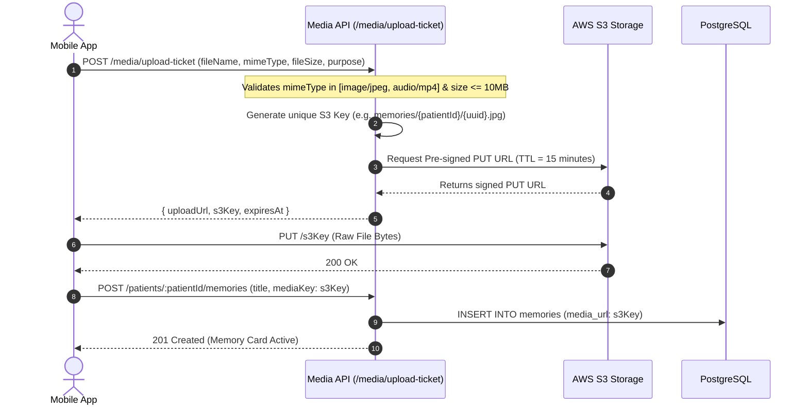

# SureStep V1 — API Design Specification

**Version:** 1.0  
**Status:** Approved Technical Architecture  
**Baseline Requirements:** `docs/requirements/V1_REQUIREMENT.md`  
**Baseline Workflows:** `docs/workflows/01-IDENTITY.md` through `11-ACCOUNT-AND-SETTINGS.md`  
**Protocol:** RESTful HTTPS JSON + WebSocket (Socket.IO 4.8)  
**Base URL:** `/api/v1`

---

## 1. API Architecture Principles

1. **Workflow-Driven Domain Endpoints:** No generic, uncontrolled CRUD endpoints. Every mutating endpoint maps directly to an authorized transition in the V1 workflows.
2. **Deterministic Status & Error Envelope:** All responses follow a standardized JSON envelope:
   ```json
   {
     "success": true,
     "data": {},
     "meta": { "timestamp": "2026-10-16T02:00:00Z", "traceId": "uuid" }
   }
   ```
   Errors return descriptive domain codes:
   ```json
   {
     "success": false,
     "error": {
       "code": "INSUFFICIENT_PERMISSIONS",
       "message": "User lacks 'Manage Caregiver Relationships' permission in this Care Circle",
       "details": {}
     }
   }
   ```
3. **Idempotency:** Critical write operations (care requests, alert acknowledgments, routine sign-offs) support the `Idempotency-Key: <uuid>` header to prevent duplicate execution during network retries.

---

## 2. Domain Endpoints Specification

### 2.1 Identity & Account Domain (Workflows 01 & 11)

#### `POST /auth/verify-session`
- **Workflow:** 01-IDENTITY §2
- **Auth:** `Bearer <firebase_token>`
- **Payload:** `{ "deviceToken": "fcm_token_string", "deviceType": "ANDROID" }`
- **Success (200):** User profile, assigned roles, and registered Care Circles.
- **Side Effects:** Upserts `device_registry`, updates `last_seen_at`.

#### `POST /account/deactivate`
- **Workflow:** 11-ACCOUNT-AND-SETTINGS §4
- **Auth:** Authenticated User
- **Payload:** `{ "reason": "TEMPORARY_PAUSE" }`
- **Success (200):** `{ "status": "DEACTIVATED", "deactivatedAt": "..." }`
- **State Transition:** `users.is_active = FALSE`.
- **Side Effects:** Invalidation of active Firebase tokens, socket disconnection.

#### `POST /account/delete-request`
- **Workflow:** 11-ACCOUNT-AND-SETTINGS §5
- **Auth:** Authenticated User
- **Payload:** `{ "confirmation": "DELETE_MY_ACCOUNT" }`
- **Success (202):** `{ "requestId": "uuid", "coolingOffExpiresAt": "..." }`
- **State Transition:** Creates `account_deletion_requests` row (`REQUESTED`).

---

### 2.2 Care Circle & Permissions Domain (Workflow 03)

#### `POST /care-circles`
- **Workflow:** 03-CARE-CIRCLE §2
- **Auth:** User with `role = 'FAMILY'`
- **Payload:** `{ "name": "Sharma Family Care Circle", "primaryPatientId": "uuid" }`
- **Success (201):** Circle object, creator auto-assigned as `OWNER`.
- **Side Effects:** Emits `circle:created` audit log.

#### `POST /care-circles/:circleId/members/invite`
- **Workflow:** 03-CARE-CIRCLE §3
- **Auth:** Circle Owner OR member holding `Manage Member Permissions`
- **Payload:** `{ "phone": "+919876543210", "roleInCircle": "MEMBER" }`
- **Success (201):** `{ "inviteCode": "XYZ123", "expiresAt": "..." }`
- **Side Effects:** Sends SMS invite with app download link.

#### `POST /care-circles/:circleId/members/:memberId/permissions`
- **Workflow:** 03-CARE-CIRCLE §5
- **Auth:** Circle Owner OR member holding `Manage Member Permissions`
- **Validation Rule:** Delegated members cannot grant/revoke `Manage Member Permissions` itself or promote themselves.
- **Payload:**
  ```json
  {
    "action": "GRANT",
    "permission": "Manage Caregiver Relationships"
  }
  ```
- **Success (200):** Updated permissions array for the target member.
- **Failure (403):** `DELEGATION_AUTHORITY_EXCEEDED`
- **Side Effects:** Writes to `circle_permission_delegations` and `audit_logs`. Emits `user:permissions-updated` via WebSocket.

---

### 2.3 Caregiver Discovery & Requests Domain (Workflows 05 & 06)

#### `GET /caregivers/discover`
- **Workflow:** 05-CAREGIVER-DISCOVERY §2
- **Auth:** Family Member or Patient holding `Search/Request Caregivers`
- **Query Params:** `city=Bangalore&radiusKm=15&availability=DAY&experienceYears=2`
- **Success (200):** List of public profiles (`is_discoverable = TRUE` only). Note: No credentials verification badge (self-reported only).

#### `POST /care-requests`
- **Workflow:** 05-CAREGIVER-DISCOVERY §4
- **Auth:** Member holding `Search/Request Caregivers`
- **Headers:** `Idempotency-Key: <uuid>`
- **Payload:**
  ```json
  {
    "circleId": "uuid",
    "patientId": "uuid",
    "caregiverId": "uuid",
    "scheduleType": "FULL_TIME",
    "proposedRate": 25000.00,
    "startDate": "2026-11-01",
    "notes": "Experienced with mobility assistance"
  }
  ```
- **Success (201):** Request object (`status: PENDING`, `expiresAt: NOW() + 72 hours`).
- **Side Effects:** FCM High-Priority push to Caregiver. Audit log recorded.

#### `POST /care-requests/:id/respond`
- **Workflow:** 05-CAREGIVER-DISCOVERY §5
- **Auth:** Caregiver recipient
- **Payload:** `{ "decision": "ACCEPT" }` (or `"DECLINE"`, with `declineReason`)
- **Success (200):** If `ACCEPT`, creates `caregiver_relationships` (`status: ACTIVE`) and `patient_assignments`.
- **State Transition:** `care_requests.status = 'ACCEPTED'`.

---

### 2.4 Caregiver Relationship & 7-Day Notice Domain (Workflow 06)

#### `POST /care-relationships/:id/notice`
- **Workflow:** 06-CAREGIVER-RELATIONSHIP §3 (Approved P1 Decision)
- **Auth:** Active Caregiver for this relationship
- **Payload:**
  ```json
  {
    "reason": "RELOCATION",
    "notes": "Relocating to another city at the end of the month."
  }
  ```
- **Success (200):**
  ```json
  {
    "status": "NOTICE_PERIOD",
    "noticeStartedAt": "2026-10-16T02:00:00Z",
    "noticeExpiresAt": "2026-10-23T02:00:00Z",
    "message": "Notice period initiated. Active care access remains in effect for 7 days."
  }
  ```
- **State Transition:** `caregiver_relationships.status = 'NOTICE_PERIOD'`.
- **Side Effects:**
  - Schedules 7-day Bull delayed transition job.
  - Sends high-importance FCM push to Care Circle Family.
  - Inserts `CARE_RELATIONSHIP_NOTICE_INITIATED` into `audit_logs`.

#### `POST /care-relationships/:id/terminate-immediate`
- **Workflow:** 06-CAREGIVER-RELATIONSHIP §4
- **Auth:** Family Member holding `Manage Caregiver Relationships`
- **Payload:** `{ "reason": "SAFETY_CONCERN", "notes": "Caregiver unpunctual" }`
- **Success (200):** `{ "status": "TERMINATED_EARLY", "endedAt": "..." }`
- **State Transition:** Immediate revocation of all patient assignments and care permissions. Bull delayed job cancelled.

---

### 2.5 Location & Circle Safe Zones Domain (Workflow 08)

#### `POST /location/ping`
- **Workflow:** 08-LOCATION-AND-SAFE-ZONES §2
- **Auth:** Patient Device (`role = 'PATIENT'`)
- **Payload:**
  ```json
  {
    "lat": 12.9716,
    "lng": 77.5946,
    "accuracy": 8.5,
    "batteryPct": 78,
    "isCharging": false,
    "recordedAt": "2026-10-16T02:05:00Z"
  }
  ```
- **Success (200):** `{ "acknowledged": true }`
- **Side Effects:**
  - Appends to `location_points`.
  - Evaluates against Circle Safe Zones.
  - Emits location coordinate on WebSocket room `patient:{patientId}`.

#### `POST /care-circles/:circleId/safe-zones`
- **Workflow:** 08-LOCATION-AND-SAFE-ZONES §3
- **Auth:** Member holding `Manage Safe Zones`
- **Payload:**
  ```json
  {
    "name": "Home Perimeter",
    "zoneType": "CIRCLE",
    "centerLat": 12.9716,
    "centerLng": 77.5946,
    "radiusMeters": 250,
    "monitoredPatientIds": ["uuid-patient-1"]
  }
  ```
- **Success (201):** Safe Zone entity with attached `safe_zone_monitors`.

---

### 2.6 Safety & Alert Incidents Domain (Workflow 07)

#### `POST /alerts/sos`
- **Workflow:** 07-SAFETY §2
- **Auth:** Patient Device
- **Payload:** `{ "lat": 12.9716, "lng": 77.5946, "notes": "Manual SOS trigger" }`
- **Success (201):** Alert incident created (`severity: CRITICAL`).
- **Side Effects:**
  - Bypasses all delays; dispatches FCM High-Priority push to entire Care Circle.
  - Emits `alert:new` to room `circle:{circleId}`.

#### `POST /alerts/:alertId/respond`
- **Workflow:** 07-SAFETY §5
- **Auth:** Care Circle Member or Assigned Caregiver
- **Payload:** `{ "action": "ACKNOWLEDGE", "notes": "On my way to patient" }`
- **Success (200):** Updates status to `ACKNOWLEDGED`.
- **Side Effects:** Emits `alert:status-change` to `circle:{circleId}`.

---

### 2.7 Patient Care & Routines Domain (Workflow 04)

#### `POST /patients/:patientId/routines`
- **Workflow:** 04-PATIENT-CARE §2
- **Auth:** Member holding `Manage Routines`
- **Payload:**
  ```json
  {
    "title": "Morning Donepezil (5mg)",
    "category": "MEDICATION",
    "isCritical": true,
    "recurrencePattern": { "freq": "DAILY", "times": ["09:00"] }
  }
  ```
- **Success (201):** Routine template created; daily occurrences generated.

#### `POST /routines/occurrences/:occurrenceId/sign-off`
- **Workflow:** 04-PATIENT-CARE §4
- **Auth:** Patient (self) OR Assigned Caregiver holding active relationship
- **Headers:** `Idempotency-Key: <uuid>`
- **Payload:** `{ "notes": "Administered with glass of water" }`
- **Success (200):** Creates `routine_completions` record, sets status to `COMPLETED`.

---

### 2.8 Memories & Activities Domain (Workflow 09)

#### `POST /patients/:patientId/memories`
- **Workflow:** 09-MEMORIES-AND-ACTIVITIES §2
- **Auth:** Member holding `Manage Patient Memories`
- **Payload:**
  ```json
  {
    "title": "Summer Trip to Mysore",
    "mediaType": "PHOTO",
    "mediaKey": "s3_object_key_xyz",
    "caption": "Family gathering in front of Mysore Palace",
    "audienceScope": "ALL_CONNECTED"
  }
  ```
- **Success (201):** Memory card entity. Default audience is `ALL_CONNECTED`.

---

## 3. Real-Time WebSocket Protocols (Socket.IO 4.8)

### 3.1 Connection & Handshake
1. Client connects to `wss://api.surestep.app` with auth payload: `{ "token": "firebase_jwt" }`.
2. Server validates JWT, resolves `userId`, and binds socket to `user:{userId}`.
3. Server queries caller's authorized circles and active assigned patients, auto-joining:
   - `circle:{circleId}`
   - `patient:{patientId}`

### 3.2 Event Specifications

| Event Name | Direction | Payload | Target Scope |
| :--- | :--- | :--- | :--- |
| **`location:update`** | Server $\to$ Client | `{ patientId, lat, lng, accuracy, recordedAt }` | `patient:{patientId}` |
| **`alert:new`** | Server $\to$ Client | `{ alertId, alertType, severity, lat, lng, patientName }` | `circle:{circleId}` |
| **`alert:status-change`** | Server $\to$ Client | `{ alertId, status, responderName, action }` | `circle:{circleId}` |
| **`routine:completed`** | Server $\to$ Client | `{ occurrenceId, routineTitle, completedBy, completedAt }` | `patient:{patientId}` |
| **`user:permissions-updated`** | Server $\to$ Client | `{ circleId, permissions: [] }` | `user:{userId}` |

---

## 4. Media Upload Protocol (AWS S3 Pre-Signed URLs)



