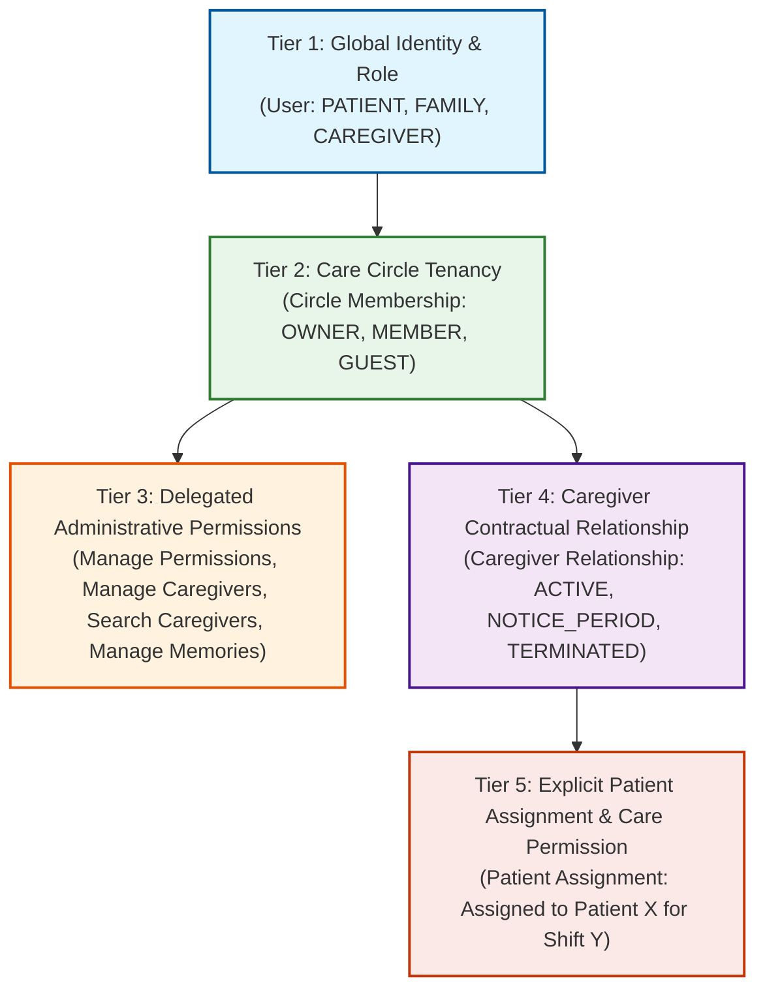
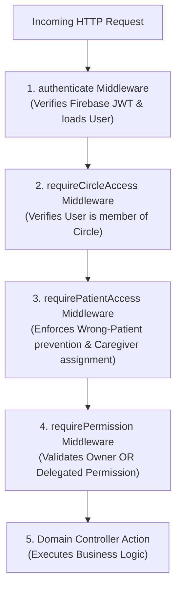

# SureStep V1 — Authorization & Access Control Architecture

**Version:** 1.0  
**Status:** Approved Technical Architecture  
**Baseline Requirements:** `docs/requirements/V1_REQUIREMENT.md`  
**Baseline Workflows:** `docs/workflows/01-IDENTITY.md` through `11-ACCOUNT-AND-SETTINGS.md`

---

## 1. Architectural Model: The 5-Tuple Policy Evaluation

Every request attempting to read, modify, or delete a resource in SureStep is evaluated against a deterministic 5-tuple:

$$\text{Decision} = \mathcal{P}(\text{Actor}, \text{Operation}, \text{Target}, \text{Context}, \text{ActivePermissions})$$

Where:
- **Actor ($\mathcal{A}$):** Authenticated user (`id`, `role`, `status`).
- **Operation ($\mathcal{O}$):** The domain action being attempted (`CREATE`, `READ`, `UPDATE`, `DELETE`, `EXECUTE`, `DELEGATE`, `REVOKE`).
- **Target ($\mathcal{T}$):** The entity being operated upon (`CareCircle`, `PatientProfile`, `SafeZone`, `Routine`, `CareRequest`, `CareRelationship`, `Memory`, `Alert`).
- **Context ($\mathcal{C}$):** The execution context, specifically:
  - `circleId`: The active Care Circle.
  - `patientId`: The targeted Patient (mandatory for all care operations).
  - `relationshipState`: Active, Notice Period, or Terminated.
- **ActivePermissions ($\mathcal{R}$):** Set of verified authorities computed at execution time from database state.

---

## 2. Decoupled Authority Hierarchy

A foundational rule of SureStep V1 is that **authority is decoupled across 5 distinct tiers**:



### Invariants:
1. **No Implicit Entitlement:** Being a Circle Member does **not** grant permission to modify routines, edit safe zones, or search for caregivers.
2. **No Role-Based Blanket Access:** A Family Member cannot access patients outside their own Care Circle. A Caregiver cannot access all patients in a Circle simply because they have a relationship with the Circle.
3. **Assignment Requirement:** A Caregiver can only read care notes, location trail, and routines for a Patient to whom they have an **active, explicit `patient_assignment`**.

---

## 3. Authority Roles & Policy Rules

### 3.1 Care Circle Owner Authority

The Care Circle Owner is the primary Family Member who created the Circle.

#### Owner-Only Operations (Non-Delegatable):
The following operations can **only** be executed by the Owner:
1. **Ownership Transfer:** Transferring Circle ownership to another Family Member.
2. **Circle Deletion:** Disbanding and permanently deleting the Care Circle.
3. **Granting/Revoking `Manage Member Permissions`:** Only the Owner can delegate or withdraw this meta-permission.
4. **Primary Patient Linking:** Adding or removing the primary Patient associated with the Circle.

#### Delegatable Permissions:
The Owner holds all permissions initially and can delegate them to eligible Circle Members:
- `Manage Member Permissions` (Delegatable meta-authority)
- `Manage Caregiver Relationships` (Contractual management & termination)
- `Search/Request Caregivers` (Discovery and sending care proposals)
- `Manage Patient Memories` (Creating, editing, deleting patient memories)
- `Manage Safe Zones` (Creating, modifying, and deleting geofenced areas)
- `Manage Routines` (Creating, modifying, and scheduling care routines/medications)

---

### 3.2 Delegated Permission Rules

When an Owner grants `Manage Member Permissions` to Member B:
1. Member B can grant or revoke any of the *operational* delegatable permissions (`Manage Caregiver Relationships`, `Search/Request Caregivers`, `Manage Patient Memories`, `Manage Safe Zones`, `Manage Routines`) to/from Member C.
2. **Self-Promotion Prevention:** Member B cannot grant themselves additional permissions.
3. **Privilege Escalation Prevention:** Member B **cannot** grant `Manage Member Permissions` to anyone else. Only the Owner can grant or revoke `Manage Member Permissions`.
4. **No Owner Override:** A delegated administrator cannot revoke the Owner’s authority or remove the Owner from the Circle.

---

### 3.3 Caregiver Lifecycle & Access Matrix

Caregiver access is tied directly to the state machine in `caregiver_relationships`:

| Operation | `ACTIVE` | `NOTICE_PERIOD` (7 Days) | `TERMINATED` | `TERMINATED_EARLY` |
| :--- | :---: | :---: | :---: | :---: |
| **View Assigned Patient Care Dashboard** | Allowed | Allowed | Denied (403) | Denied (403) |
| **View Realtime Location of Assigned Patient** | Allowed | Allowed | Denied (403) | Denied (403) |
| **Sign Off Routine Completion** | Allowed | Allowed | Denied (403) | Denied (403) |
| **Receive Safety / Geofence Alerts** | Allowed | Allowed | Denied (403) | Denied (403) |
| **Initiate Termination / Resignation** | Allowed | Denied (Already in notice) | Denied | Denied |
| **Access Other Patients in Circle** | Denied (403) | Denied (403) | Denied (403) | Denied (403) |

#### Notice Period Invariant:
- During the 7-day `NOTICE_PERIOD`, the caregiver's care permissions and patient assignments **remain 100% active**. The family cannot decline the notice.
- The Family can execute an immediate safety termination (`TERMINATED_EARLY`), which severs all access immediately.
- At the exact expiration of 7 days, the background worker transitions status to `TERMINATED` and revokes all patient assignments.

---

### 3.4 Patient Self-Access Boundaries

A user logged in with `role = 'PATIENT'`:
- **Allowed:**
  - View own daily routines, task agenda, and audio prompts.
  - Mark own routine task as completed (`completion_source = 'PATIENT_SELF'`).
  - View memory lane cards and photos scoped to `ALL_CONNECTED`.
  - Trigger manual SOS emergency alert.
  - View own profile and emergency contact information.
- **Forbidden (Server Rejection):**
  - Modifying routine definitions or medication schedules.
  - Creating, editing, or deleting Safe Zones.
  - Viewing Caregiver discovery, rates, or contract proposals.
  - Viewing or editing Circle membership and permissions.
  - Accessing telemetry or profiles of any other patient.

---

### 3.5 Wrong-Patient Prevention Framework

In multi-patient care environments (e.g., family managing both parents), cross-patient data leakage is a critical patient safety risk.

#### Architectural Enforcement:
1. **Mandatory Explicit Context:** No API route may infer patient context from the caller's session alone. Every patient-bound route must explicitly contain `:patientId` in the path (e.g., `/api/v1/patients/:patientId/routines`).
2. **Multi-Tenant Scoping Query:**
   ```sql
   SELECT 1 FROM care_circle_members ccm
   JOIN care_circles cc ON cc.id = ccm.circle_id
   JOIN patients p ON p.circle_id = cc.id
   WHERE ccm.user_id = $1 AND p.user_id = $2 AND cc.deleted_at IS NULL;
   ```
   If the targeted patient does not belong to the caller's active Circle, the request is rejected with `403 Forbidden: PATIENT_OUTSIDE_CIRCLE_SCOPE`.
3. **Caregiver Assignment Guard:**
   For caregivers, an additional check verifies active assignment:
   ```sql
   SELECT 1 FROM patient_assignments pa
   JOIN caregiver_relationships cr ON cr.id = pa.relationship_id
   WHERE cr.caregiver_id = $1 
     AND pa.patient_id = $2 
     AND cr.status IN ('ACTIVE', 'NOTICE_PERIOD')
     AND pa.is_active = TRUE;
   ```

---

## 4. Server-Side Enforcement Architecture

### 4.1 Authorization Middleware Pipeline



### 4.2 Middleware Implementations (TypeScript Design)

```typescript
// shared/middleware/guards.ts

export const requireCirclePermission = (requiredPermission: CirclePermission) => {
  return async (req: Request, res: Response, next: NextFunction): Promise<void> => {
    const userId = req.user.id;
    const circleId = req.params.circleId || req.body.circleId;

    if (!circleId) {
      throw new AppError('MISSING_CONTEXT', 'Care Circle context is required', 400);
    }

    // 1. Fetch circle membership
    const member = await db.query.careCircleMembers.findFirst({
      where: and(
        eq(careCircleMembers.circleId, circleId),
        eq(careCircleMembers.userId, userId)
      ),
      with: { circle: true, permissions: true },
    });

    if (!member) {
      throw new AppError('NOT_CIRCLE_MEMBER', 'Access denied to this Care Circle', 403);
    }

    // 2. Owner holds all permissions
    if (member.roleInCircle === 'OWNER') {
      return next();
    }

    // 3. Verify specific permission
    const hasPermission = member.permissions.some(
      (p) => p.permissionName === requiredPermission
    );

    if (!hasPermission) {
      throw new AppError(
        'INSUFFICIENT_PERMISSIONS',
        `Missing required permission: ${requiredPermission}`,
        403
      );
    }

    next();
  };
};
```

---

## 5. Revocation & Token Invalidation

1. **Immediate Authorization Revocation:**
   - Permissions are never stored inside client-side JWTs.
   - JWTs assert **identity only** (`userId`).
   - Every protected request performs an indexed database lookup against active permissions and assignments.
   - Therefore, permission revocations take effect on the **next HTTP request** (zero propagation latency).
2. **Session Termination & Invalidation:**
   - When a user's account is suspended or deleted, the backend invokes `adminAuth.revokeRefreshTokens(firebaseUid)`.
   - The user's active socket connections are immediately disconnected: `io.to('user:' + userId).disconnectSockets(true)`.
3. **Post-Revocation Data Isolation:**
   - Terminated caregivers cannot access historical patient data, reports, or location trails.
   - Attempting to access past patients yields `403 Forbidden: CAREGIVER_RELATIONSHIP_TERMINATED`.

