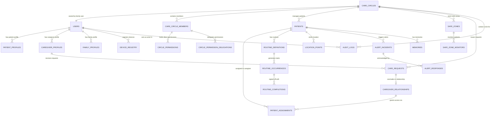

# SureStep V1 — Data Model Architecture

**Version:** 1.0  
**Status:** Approved Technical Architecture  
**Baseline Requirements:** `docs/requirements/V1_REQUIREMENT.md`  
**Baseline Workflows:** `docs/workflows/01-IDENTITY.md` through `11-ACCOUNT-AND-SETTINGS.md`  
**Database Engine:** PostgreSQL 16 with PostGIS extension  
**ORM:** Drizzle ORM (TypeScript)

---

## 1. Data Model Principles & Architectural Boundaries

1. **Decoupled Identity and Circle Tenancy:**
   - A `User` is an independent global identity tied to a phone number and Firebase authentication.
   - A `CareCircle` is the central operational unit. All patient care, monitoring rules, and caregiver relationships exist within or relate to a Care Circle.
2. **Explicit Authority Decoupling:**
   - Circle Membership $\neq$ Caregiver Relationship $\neq$ Patient Assignment $\neq$ Specific Permission.
   - A user's authority is computed dynamically from their membership, role, delegations, and active assignments.
3. **Immutability of Telemetry & Audits:**
   - Location points, alert incidents, and audit log entries are append-only. No updates or deletions are permitted during regular operation.
4. **No Diagnostic / MMSE Entities:**
   - All legacy clinical tables (`50_cognition.sql`, `cognitive_assessments`, `mmse_scores`) are excluded from the V1 schema.

---

## 2. Entity-Relationship Diagram (ERD)

---

## 3. Core Entity Specifications

### 3.1 Identity & Profiles Domain

#### 1. `users`
Global identity entity. Represents any person interacting with the system.
- **Primary Key:** `id UUID DEFAULT gen_random_uuid()`
- **Key Columns:**
  - `firebase_uid VARCHAR(128) NOT NULL UNIQUE`
  - `phone VARCHAR(20) NOT NULL UNIQUE` (E.164 format)
  - `name VARCHAR(100) NOT NULL`
  - `role VARCHAR(20) NOT NULL` (`PATIENT`, `FAMILY`, `CAREGIVER`)
  - `preferred_language VARCHAR(10) NOT NULL DEFAULT 'en'`
  - `avatar_url TEXT`
  - `is_active BOOLEAN NOT NULL DEFAULT TRUE`
  - `created_at TIMESTAMPTZ NOT NULL DEFAULT NOW()`
  - `updated_at TIMESTAMPTZ NOT NULL DEFAULT NOW()`
  - `deleted_at TIMESTAMPTZ` (Soft delete)
- **Delete Behavior:** Cannot be hard deleted if linked to active Care Circles or relationships. Soft delete cascades deactivation.
- **Sensitivity:** High (PII).

#### 2. `patient_profiles`
Health and care context for users with `role = 'PATIENT'`.
- **Primary Key:** `user_id UUID PRIMARY KEY REFERENCES users(id) ON DELETE CASCADE`
- **Key Columns:**
  - `preferred_name VARCHAR(100)`
  - `date_of_birth DATE`
  - `emergency_contact_name VARCHAR(100) NOT NULL`
  - `emergency_contact_phone VARCHAR(20) NOT NULL`
  - `primary_doctor_name VARCHAR(100)`
  - `primary_doctor_phone VARCHAR(20)`
  - `allergies TEXT[] NOT NULL DEFAULT '{}'`
  - `comfort_items TEXT[] NOT NULL DEFAULT '{}'`
  - `known_triggers TEXT[] NOT NULL DEFAULT '{}'`
  - `care_notes_summary TEXT`
  - `updated_at TIMESTAMPTZ NOT NULL DEFAULT NOW()`
- **Sensitivity:** High (Sensitive Health Data).

#### 3. `caregiver_profiles`
Professional credentials and discovery attributes for users with `role = 'CAREGIVER'`.
- **Primary Key:** `user_id UUID PRIMARY KEY REFERENCES users(id) ON DELETE CASCADE`
- **Key Columns (7 Mandatory Onboarding Fields for Discoverability):**
  - `years_of_experience INTEGER NOT NULL DEFAULT 0`
  - `languages_spoken TEXT[] NOT NULL DEFAULT '{}'`
  - `service_city VARCHAR(100)`
  - `service_radius_km INTEGER NOT NULL DEFAULT 10`
  - `care_capabilities TEXT[] NOT NULL DEFAULT '{}'`
  - `availability_type VARCHAR(50) NOT NULL DEFAULT 'DAY'`
  - `hourly_rate NUMERIC(10, 2)`
  - `is_discoverable BOOLEAN NOT NULL DEFAULT FALSE` (Defaults to FALSE until all 7 fields complete)
  - `has_dementia_training BOOLEAN NOT NULL DEFAULT FALSE` (Self-reported)
  - `bio TEXT`
  - `rating NUMERIC(3, 2) DEFAULT 5.00`
  - `rating_count INTEGER NOT NULL DEFAULT 0`
  - `updated_at TIMESTAMPTZ NOT NULL DEFAULT NOW()`
- **Indexes:** `idx_caregiver_search ON caregiver_profiles(service_city, is_discoverable)`
- **Sensitivity:** Low / Public Directory.

---

### 3.2 Care Circle & Permission Domain

#### 4. `care_circles`
The root operational boundary for patient care.
- **Primary Key:** `id UUID DEFAULT gen_random_uuid()`
- **Key Columns:**
  - `name VARCHAR(100) NOT NULL`
  - `owner_id UUID NOT NULL REFERENCES users(id) ON DELETE RESTRICT`
  - `created_at TIMESTAMPTZ NOT NULL DEFAULT NOW()`
  - `updated_at TIMESTAMPTZ NOT NULL DEFAULT NOW()`
  - `deleted_at TIMESTAMPTZ`
- **Tenant Boundary:** Top-level tenant. All child records belong to a `care_circle_id`.
- **Sensitivity:** Medium.

#### 5. `care_circle_members`
Association between a User and a Care Circle.
- **Primary Key:** `id UUID DEFAULT gen_random_uuid()`
- **Foreign Keys:**
  - `circle_id UUID NOT NULL REFERENCES care_circles(id) ON DELETE CASCADE`
  - `user_id UUID NOT NULL REFERENCES users(id) ON DELETE CASCADE`
- **Key Columns:**
  - `role_in_circle VARCHAR(30) NOT NULL` (`OWNER`, `MEMBER`, `CAREGIVER`)
  - `joined_at TIMESTAMPTZ NOT NULL DEFAULT NOW()`
  - `invited_by UUID REFERENCES users(id)`
- **Unique Constraint:** `UNIQUE (circle_id, user_id)`

#### 6. `circle_permissions`
Granular, delegatable permissions held by a circle member.
- **Primary Key:** `id UUID DEFAULT gen_random_uuid()`
- **Foreign Keys:**
  - `member_id UUID NOT NULL REFERENCES care_circle_members(id) ON DELETE CASCADE`
- **Key Columns:**
  - `permission_name VARCHAR(50) NOT NULL`
    - Canonical Delegatable Names:
      - `Manage Member Permissions`
      - `Manage Caregiver Relationships`
      - `Search/Request Caregivers`
      - `Manage Patient Memories`
      - `Manage Safe Zones`
      - `Manage Routines`
  - `granted_by UUID NOT NULL REFERENCES users(id)`
  - `granted_at TIMESTAMPTZ NOT NULL DEFAULT NOW()`
- **Unique Constraint:** `UNIQUE (member_id, permission_name)`

#### 7. `circle_permission_delegations`
Audit trail of who delegated which permission to whom within a Circle.
- **Primary Key:** `id UUID DEFAULT gen_random_uuid()`
- **Foreign Keys:**
  - `circle_id UUID NOT NULL REFERENCES care_circles(id) ON DELETE CASCADE`
  - `delegator_id UUID NOT NULL REFERENCES users(id)`
  - `delegatee_id UUID NOT NULL REFERENCES users(id)`
- **Key Columns:**
  - `permission_name VARCHAR(50) NOT NULL`
  - `action VARCHAR(10) NOT NULL` (`GRANT`, `REVOKE`)
  - `created_at TIMESTAMPTZ NOT NULL DEFAULT NOW()`

---

### 3.3 Caregiver Relationship & Assignment Domain

#### 8. `care_requests`
Care proposals initiated by Family to Professional Caregivers.
- **Primary Key:** `id UUID DEFAULT gen_random_uuid()`
- **Foreign Keys:**
  - `circle_id UUID NOT NULL REFERENCES care_circles(id) ON DELETE RESTRICT`
  - `patient_id UUID NOT NULL REFERENCES users(id) ON DELETE RESTRICT`
  - `requester_id UUID NOT NULL REFERENCES users(id) ON DELETE RESTRICT`
  - `caregiver_id UUID NOT NULL REFERENCES users(id) ON DELETE RESTRICT`
- **Key Columns:**
  - `status VARCHAR(20) NOT NULL DEFAULT 'PENDING'` (`PENDING`, `ACCEPTED`, `DECLINED`, `WITHDRAWN`, `EXPIRED`)
  - `schedule_type VARCHAR(20) NOT NULL` (`FULL_TIME`, `PART_TIME`, `HOURLY`)
  - `proposed_rate NUMERIC(10, 2) NOT NULL`
  - `start_date DATE NOT NULL`
  - `notes TEXT`
  - `decline_reason VARCHAR(100)`
  - `withdraw_reason VARCHAR(100)`
  - `expires_at TIMESTAMPTZ NOT NULL` (Defaults to `NOW() + INTERVAL '72 hours'`)
  - `created_at TIMESTAMPTZ NOT NULL DEFAULT NOW()`
  - `updated_at TIMESTAMPTZ NOT NULL DEFAULT NOW()`
- **Indexes:** `idx_care_requests_caregiver ON care_requests(caregiver_id, status)`

#### 9. `caregiver_relationships`
Active or concluding professional engagement between a Care Circle and a Caregiver.
- **Primary Key:** `id UUID DEFAULT gen_random_uuid()`
- **Foreign Keys:**
  - `circle_id UUID NOT NULL REFERENCES care_circles(id) ON DELETE RESTRICT`
  - `caregiver_id UUID NOT NULL REFERENCES users(id) ON DELETE RESTRICT`
  - `originating_request_id UUID REFERENCES care_requests(id)`
- **Key Columns & 7-Day Notice State Machine:**
  - `status VARCHAR(30) NOT NULL DEFAULT 'ACTIVE'` (`ACTIVE`, `NOTICE_PERIOD`, `TERMINATED`, `TERMINATED_EARLY`)
  - `notice_started_at TIMESTAMPTZ`
  - `notice_expires_at TIMESTAMPTZ` (Set to `notice_started_at + INTERVAL '7 days'`)
  - `termination_reason VARCHAR(100)`
  - `termination_initiator VARCHAR(20)` (`CAREGIVER`, `FAMILY`)
  - `termination_notes TEXT`
  - `started_at TIMESTAMPTZ NOT NULL DEFAULT NOW()`
  - `ended_at TIMESTAMPTZ`
- **Unique Constraint:** Active relationship constraint `UNIQUE (circle_id, caregiver_id)` WHERE `status IN ('ACTIVE', 'NOTICE_PERIOD')`

#### 10. `patient_assignments`
Explicit mapping of an active Caregiver to specific Patients within a Care Circle.
- **Primary Key:** `id UUID DEFAULT gen_random_uuid()`
- **Foreign Keys:**
  - `relationship_id UUID NOT NULL REFERENCES caregiver_relationships(id) ON DELETE CASCADE`
  - `patient_id UUID NOT NULL REFERENCES users(id) ON DELETE CASCADE`
- **Key Columns:**
  - `assigned_at TIMESTAMPTZ NOT NULL DEFAULT NOW()`
  - `assigned_by UUID NOT NULL REFERENCES users(id)`
  - `is_active BOOLEAN NOT NULL DEFAULT TRUE`
- **Unique Constraint:** `UNIQUE (relationship_id, patient_id)`

---

### 3.4 Location & Safety Domain

#### 11. `safe_zones`
Geofenced perimeters owned by the Care Circle.
- **Primary Key:** `id UUID DEFAULT gen_random_uuid()`
- **Foreign Keys:**
  - `circle_id UUID NOT NULL REFERENCES care_circles(id) ON DELETE CASCADE`
  - `created_by UUID NOT NULL REFERENCES users(id)`
- **Key Columns:**
  - `name VARCHAR(100) NOT NULL` (e.g., "Home", "Day Care Center")
  - `zone_type VARCHAR(20) NOT NULL DEFAULT 'CIRCLE'` (`CIRCLE`, `POLYGON`)
  - `center_lat DOUBLE PRECISION`
  - `center_lng DOUBLE PRECISION`
  - `radius_meters INTEGER`
  - `polygon_coordinates JSONB` (Array of [lat, lng] for custom perimeters)
  - `is_active BOOLEAN NOT NULL DEFAULT TRUE`
  - `created_at TIMESTAMPTZ NOT NULL DEFAULT NOW()`
  - `updated_at TIMESTAMPTZ NOT NULL DEFAULT NOW()`

#### 12. `safe_zone_monitors`
Configuration linking specific Patients to Safe Zones within the Circle.
- **Primary Key:** `id UUID DEFAULT gen_random_uuid()`
- **Foreign Keys:**
  - `safe_zone_id UUID NOT NULL REFERENCES safe_zones(id) ON DELETE CASCADE`
  - `patient_id UUID NOT NULL REFERENCES users(id) ON DELETE CASCADE`
- **Key Columns:**
  - `alert_on_exit BOOLEAN NOT NULL DEFAULT TRUE`
  - `alert_on_entry BOOLEAN NOT NULL DEFAULT FALSE`
  - `monitoring_schedule JSONB` (Optional day/time active windows)
- **Unique Constraint:** `UNIQUE (safe_zone_id, patient_id)`

#### 13. `location_points`
Immutable raw GPS telemetry emitted by patient devices.
- **Primary Key:** `id UUID DEFAULT gen_random_uuid()`
- **Foreign Keys:**
  - `patient_id UUID NOT NULL REFERENCES users(id) ON DELETE CASCADE`
- **Key Columns:**
  - `lat DOUBLE PRECISION NOT NULL`
  - `lng DOUBLE PRECISION NOT NULL`
  - `accuracy DOUBLE PRECISION NOT NULL` (Meters)
  - `altitude DOUBLE PRECISION`
  - `speed DOUBLE PRECISION`
  - `battery_pct INTEGER`
  - `is_charging BOOLEAN`
  - `recorded_at TIMESTAMPTZ NOT NULL`
  - `created_at TIMESTAMPTZ NOT NULL DEFAULT NOW()`
- **Partitioning Strategy:** Partitioned monthly by `recorded_at` for high-throughput scaling.
- **Indexes:** `idx_location_patient_time ON location_points(patient_id, recorded_at DESC)`

#### 14. `alert_incidents`
Safety alarms requiring immediate Care Circle awareness and response.
- **Primary Key:** `id UUID DEFAULT gen_random_uuid()`
- **Foreign Keys:**
  - `circle_id UUID NOT NULL REFERENCES care_circles(id) ON DELETE CASCADE`
  - `patient_id UUID NOT NULL REFERENCES users(id) ON DELETE CASCADE`
  - `safe_zone_id UUID REFERENCES safe_zones(id) ON DELETE SET NULL`
- **Key Columns:**
  - `alert_type VARCHAR(30) NOT NULL` (`SOS_MANUAL`, `ZONE_EXIT`, `NO_SIGNAL`, `CRITICAL_ROUTINE_MISSED`, `LOW_BATTERY`)
  - `severity VARCHAR(20) NOT NULL` (`CRITICAL`, `WARNING`, `INFO`)
  - `status VARCHAR(20) NOT NULL DEFAULT 'ACTIVE'` (`ACTIVE`, `ACKNOWLEDGED`, `RESOLVED`, `FALSE_ALARM`)
  - `trigger_lat DOUBLE PRECISION`
  - `trigger_lng DOUBLE PRECISION`
  - `dedup_key VARCHAR(100) UNIQUE`
  - `created_at TIMESTAMPTZ NOT NULL DEFAULT NOW()`
  - `resolved_at TIMESTAMPTZ`

#### 15. `alert_responses`
Log of actions taken by responders to an alert incident.
- **Primary Key:** `id UUID DEFAULT gen_random_uuid()`
- **Foreign Keys:**
  - `alert_id UUID NOT NULL REFERENCES alert_incidents(id) ON DELETE CASCADE`
  - `responder_id UUID NOT NULL REFERENCES users(id)`
- **Key Columns:**
  - `response_action VARCHAR(30) NOT NULL` (`ACKNOWLEDGE`, `RESOLVE`, `DISMISS`)
  - `notes TEXT`
  - `created_at TIMESTAMPTZ NOT NULL DEFAULT NOW()`

---

### 3.5 Patient Care & Routines Domain

#### 16. `routine_definitions`
Master templates for daily medications, activities, and care tasks.
- **Primary Key:** `id UUID DEFAULT gen_random_uuid()`
- **Foreign Keys:**
  - `patient_id UUID NOT NULL REFERENCES users(id) ON DELETE CASCADE`
  - `created_by UUID NOT NULL REFERENCES users(id)`
- **Key Columns:**
  - `title VARCHAR(150) NOT NULL`
  - `category VARCHAR(30) NOT NULL` (`MEDICATION`, `MEAL`, `EXERCISE`, `HYGIENE`, `APPOINTMENT`)
  - `description TEXT`
  - `is_critical BOOLEAN NOT NULL DEFAULT FALSE` (Critical routines escalate if missed)
  - `recurrence_pattern JSONB NOT NULL` (e.g. `{"freq": "DAILY", "times": ["08:00", "20:00"]}`)
  - `audio_prompt_url TEXT`
  - `is_active BOOLEAN NOT NULL DEFAULT TRUE`
  - `created_at TIMESTAMPTZ NOT NULL DEFAULT NOW()`
  - `updated_at TIMESTAMPTZ NOT NULL DEFAULT NOW()`

#### 17. `routine_occurrences`
Individual daily scheduled tasks generated from definitions.
- **Primary Key:** `id UUID DEFAULT gen_random_uuid()`
- **Foreign Keys:**
  - `routine_id UUID NOT NULL REFERENCES routine_definitions(id) ON DELETE CASCADE`
  - `patient_id UUID NOT NULL REFERENCES users(id) ON DELETE CASCADE`
- **Key Columns:**
  - `scheduled_date DATE NOT NULL`
  - `scheduled_time TIME NOT NULL`
  - `status VARCHAR(20) NOT NULL DEFAULT 'PENDING'` (`PENDING`, `COMPLETED`, `MISSED`, `SNOOZED`, `SKIPPED`)
  - `snooze_count INTEGER NOT NULL DEFAULT 0`
  - `snoozed_until TIMESTAMPTZ`
  - `created_at TIMESTAMPTZ NOT NULL DEFAULT NOW()`
- **Unique Constraint:** `UNIQUE (routine_id, scheduled_date, scheduled_time)`

#### 18. `routine_completions`
Sign-off evidence for completed routine tasks.
- **Primary Key:** `id UUID DEFAULT gen_random_uuid()`
- **Foreign Keys:**
  - `occurrence_id UUID NOT NULL REFERENCES routine_occurrences(id) ON DELETE CASCADE`
  - `completed_by UUID NOT NULL REFERENCES users(id)`
- **Key Columns:**
  - `completion_source VARCHAR(20) NOT NULL` (`PATIENT_SELF`, `CAREGIVER_ASSISTED`, `FAMILY`)
  - `notes TEXT`
  - `completed_at TIMESTAMPTZ NOT NULL DEFAULT NOW()`

---

### 3.6 Memories & Activities Domain

#### 19. `memories`
Patient memory cards, photos, and voice notes.
- **Primary Key:** `id UUID DEFAULT gen_random_uuid()`
- **Foreign Keys:**
  - `patient_id UUID NOT NULL REFERENCES users(id) ON DELETE CASCADE`
  - `creator_id UUID NOT NULL REFERENCES users(id)`
- **Key Columns:**
  - `title VARCHAR(150) NOT NULL`
  - `media_type VARCHAR(20) NOT NULL` (`PHOTO`, `AUDIO`, `STORY`)
  - `media_url TEXT NOT NULL`
  - `caption TEXT`
  - `tagged_persons TEXT[] NOT NULL DEFAULT '{}'`
  - `memory_year INTEGER`
  - `audience_scope VARCHAR(20) NOT NULL DEFAULT 'ALL_CONNECTED'` (`ALL_CONNECTED`, `FAMILY_ONLY`)
  - `created_at TIMESTAMPTZ NOT NULL DEFAULT NOW()`
  - `updated_at TIMESTAMPTZ NOT NULL DEFAULT NOW()`

---

### 3.7 Governance, Audit & Telemetry Domain

#### 20. `audit_logs`
Immutable system audit ledger.
- **Primary Key:** `id UUID DEFAULT gen_random_uuid()`
- **Foreign Keys:**
  - `actor_id UUID REFERENCES users(id) ON DELETE SET NULL`
  - `circle_id UUID REFERENCES care_circles(id) ON DELETE SET NULL`
  - `patient_id UUID REFERENCES users(id) ON DELETE SET NULL`
- **Key Columns:**
  - `action VARCHAR(50) NOT NULL`
  - `entity_type VARCHAR(50) NOT NULL`
  - `entity_id VARCHAR(50) NOT NULL`
  - `previous_state JSONB`
  - `new_state JSONB`
  - `ip_address VARCHAR(45)`
  - `user_agent TEXT`
  - `created_at TIMESTAMPTZ NOT NULL DEFAULT NOW()`
- **Access Rule:** Application credentials have `INSERT` and `SELECT` only. No `UPDATE` or `DELETE` allowed.

#### 21. `account_deletion_requests`
Audit record for GDPR/DPDP-compliant account deletion and retention cycles.
- **Primary Key:** `id UUID DEFAULT gen_random_uuid()`
- **Foreign Keys:**
  - `user_id UUID NOT NULL REFERENCES users(id)`
- **Key Columns:**
  - `status VARCHAR(20) NOT NULL DEFAULT 'REQUESTED'` (`REQUESTED`, `PROCESSING`, `COMPLETED`, `CANCELLED`)
  - `cooling_off_expires_at TIMESTAMPTZ NOT NULL`
  - `requested_at TIMESTAMPTZ NOT NULL DEFAULT NOW()`
  - `completed_at TIMESTAMPTZ`

