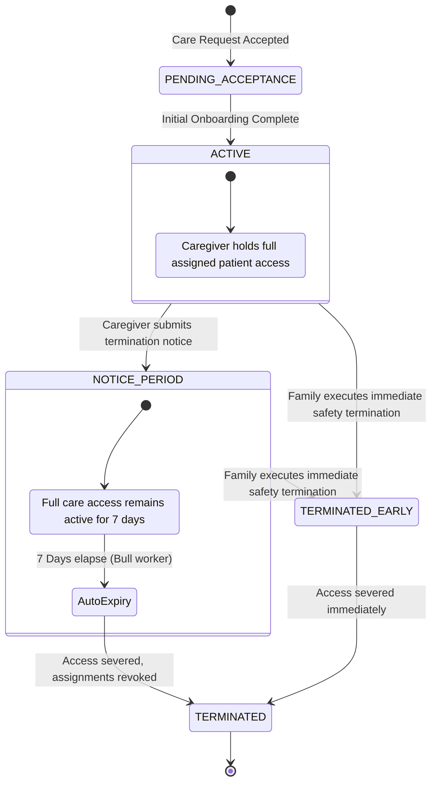
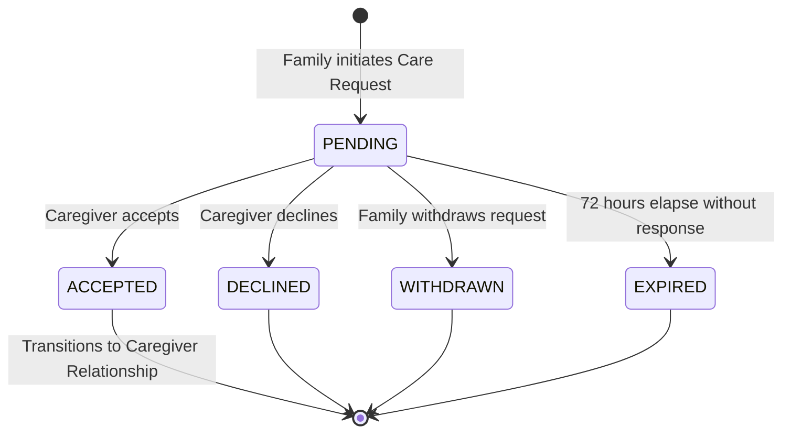
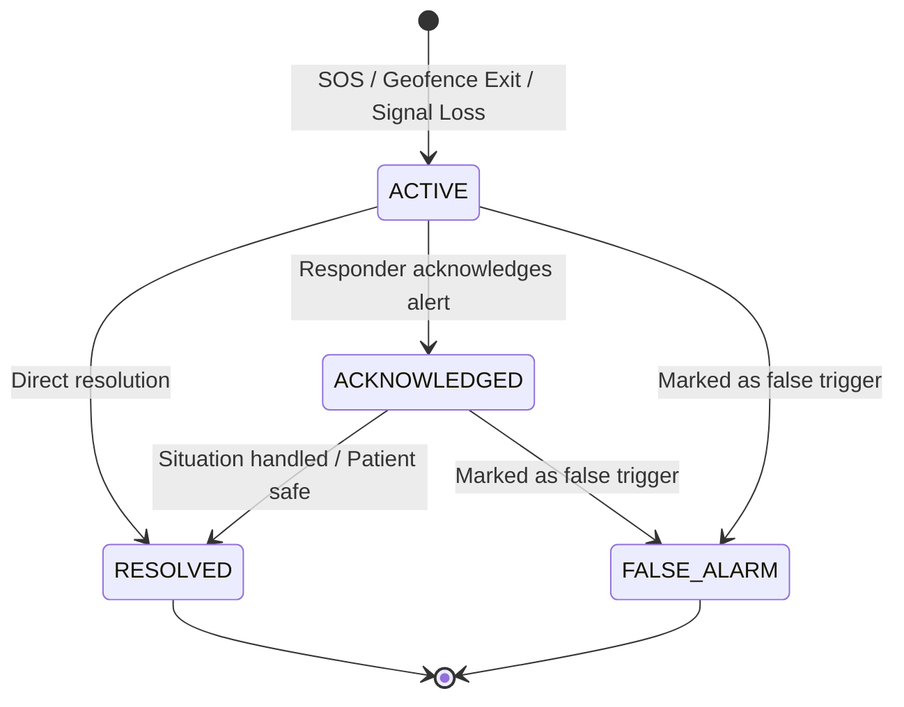
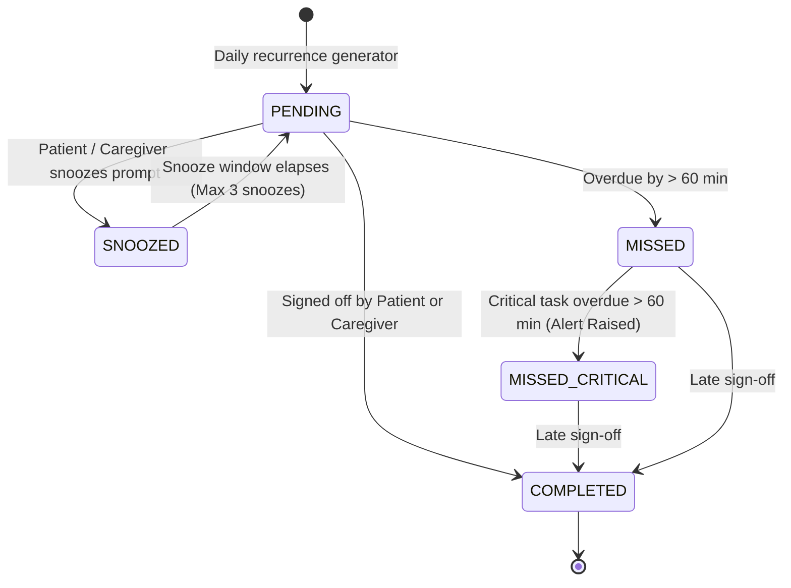

# SureStep V1 — State Machines, Policies & Traceability Matrix

**Version:** 1.0  
**Status:** Approved Technical Architecture  
**Baseline Requirements:** `docs/requirements/V1_REQUIREMENT.md`  
**Baseline Workflows:** `docs/workflows/01-IDENTITY.md` through `11-ACCOUNT-AND-SETTINGS.md`

---

## 1. Domain State Machines & Lifecycle Specifications

SureStep V1 uses strict, deterministic state machines across all safety and relational lifecycles. No transition may occur outside the authorized rules.

### 1.1 Caregiver Relationship Lifecycle (Approved P1 Decision)

#### State Transition Rules:
| Current State | Event / Trigger | Actor | Target State | Invariants & Side Effects |
| :--- | :--- | :--- | :--- | :--- |
| `ACTIVE` | `caregiver_submit_notice` | Caregiver | `NOTICE_PERIOD` | Sets `notice_started_at = NOW()`, `notice_expires_at = NOW() + 7 days`. Schedules delayed Bull job. Care access continues uninterrupted. Family cannot decline notice. |
| `ACTIVE` | `family_terminate_immediate` | Family (Owner / Delegate) | `TERMINATED_EARLY` | Immediate safety termination. Cancels delayed job. Revokes all patient assignments and care permissions instantly. Emits audit log. |
| `NOTICE_PERIOD` | `family_terminate_immediate` | Family (Owner / Delegate) | `TERMINATED_EARLY` | Cancels 7-day countdown. Revokes all access immediately. |
| `NOTICE_PERIOD` | `timer_expired_7_days` | System (Bull Job) | `TERMINATED` | Automatic transition. All patient assignments revoked. Emits audit log and FCM alerts to both parties. |

---

### 1.2 Care Request Lifecycle

#### State Transition Rules:
- **`PENDING` $\to$ `ACCEPTED`:** Creates `caregiver_relationships` in `ACTIVE` state, maps `patient_assignments`.
- **`PENDING` $\to$ `DECLINED`:** Requires canonical `decline_reason` (e.g., `UNAVAILABLE_SCHEDULE`, `OUTSIDE_SERVICE_AREA`, `RATE_MISMATCH`).
- **`PENDING` $\to$ `WITHDRAWN`:** Family withdraws before response.
- **`PENDING` $\to$ `EXPIRED`:** System worker sweeps requests where `NOW() > expires_at` (72 hours).

---

### 1.3 Alert Incident Lifecycle

#### Invariants:
1. An `ACTIVE` alert continuously surfaces in the High-Priority Alert Banner across all connected Care Circle apps until marked `ACKNOWLEDGED` or `RESOLVED`.
2. Acknowledging an alert claims responsibility and records `responder_id` and timestamp without terminating the safety watch until `RESOLVED`.

---

### 1.4 Routine Occurrence Lifecycle

---

## 2. Longitudinal Data Boundary & Telemetry Policy

SureStep V1 establishes an uncompromising technical boundary regarding health and longitudinal data:

### 2.1 The Non-Diagnostic Telemetry Principle
1. **Raw Telemetry Storage Only:** The database stores timestamped raw metrics:
   - Location coordinates (`lat`, `lng`, `accuracy`, `speed`, `battery_pct`)
   - Routine completion timestamps and sign-off identities
   - Observational care notes written by family or caregivers
   - Low-frustration cognitive engagement activity logs (play count, session duration)
2. **Strict Prohibition of Clinical Interpretation:**
   - No MMSE (Mini-Mental State Examination) scoring or staging.
   - No algorithmic "Cognitive Decline Scores", "Attention Ratings", or "Memory Scores".
   - No machine learning prediction of Alzheimer's progression or clinical deterioration.
   - No clinical recommendations or dosage adjustments.
3. **Data Retention & Aggregation:**
   - Raw location points are retained for 90 days in operational storage, then moved to cold archive.
   - Care notes and routine logs are retained for the lifetime of the active Care Circle to ensure longitudinal continuity for visiting physicians and family members.

---

## 3. Security, Privacy & Data Isolation

### 3.1 Wrong-Patient Prevention Framework
To prevent medication errors, identity confusion, or cross-patient data exposure:
1. **Mandatory Patient Scoping:** Every screen and API endpoint touching patient data requires explicit `patientId`.
2. **Persistent Visual Context:** The mobile frontend renders a persistent, non-dismissible Patient Context Bar across all dashboards:
   - Patient Photo / Avatar
   - Full Legal / Preferred Name
   - Emergency Contact Quick-Dial
   - Primary Caregiver Badge
3. **Multi-Patient Switching Guard:** When a Family Member switches between patients (e.g., Mother vs Father), all in-memory caches, active WebSocket subscriptions, and draft notes are cleared.

### 3.2 Session & Data Lifecycle
- **Session Expiration:** Firebase ID tokens expire after 60 minutes. Mobile clients refresh tokens automatically. Backend guards verify `auth_time` to reject revoked sessions.
- **Account Deletion (GDPR / DPDP Compliance):**
  - Soft-deletion with a 14-day cooling-off window.
  - After 14 days, personal PII (name, phone, photo) is hard-deleted or cryptographically anonymized.
  - Safety incident logs retain anonymized UUIDs for statutory liability protection.

---

## 4. Requirements & Workflows Traceability Matrix

| Requirement / Workflow Section | Product Baseline Rule | Technical Architecture Implementation | Traceability Verification |
| :--- | :--- | :--- | :--- |
| **Req §1 / WF 01 (Identity)** | Phone OTP login; 3 explicit roles (Patient, Family, Caregiver); single active role per session. | Firebase Phone Auth + `users` table + `AuthContext.tsx` role routing. | [SYSTEM_ARCHITECTURE.md §3.3](file:///home/mrpanther/dev/SureStep-Dementia/docs/architecture/SYSTEM_ARCHITECTURE.md), [DATA_MODEL.md §3.1](file:///home/mrpanther/dev/SureStep-Dementia/docs/architecture/DATA_MODEL.md) |
| **Req §2 / WF 02 (Patient)** | Simplified UI; background tracking; emergency contacts; no cognitive testing. | `PatientNavigator.tsx`, `backgroundLocationService.ts`, `patient_profiles`. Prohibited MMSE routes removed. | [CODEBASE_AUDIT.md §3.1](file:///home/mrpanther/dev/SureStep-Dementia/docs/audits/CODEBASE_AUDIT.md), [DATA_MODEL.md §3.1](file:///home/mrpanther/dev/SureStep-Dementia/docs/architecture/DATA_MODEL.md) |
| **Req §5, §6 / WF 03 (Care Circle)** | Circle is central boundary; Owner can delegate `Manage Member Permissions` and 5 domain permissions. | `care_circles`, `care_circle_members`, `circle_permissions`, `circle_permission_delegations`. Delegated policy engine. | [DATA_MODEL.md §3.2](file:///home/mrpanther/dev/SureStep-Dementia/docs/architecture/DATA_MODEL.md), [AUTHORIZATION.md §3.1](file:///home/mrpanther/dev/SureStep-Dementia/docs/architecture/AUTHORIZATION.md) |
| **Req §2.3 / WF 04 (Patient Care)** | Routine schedules; critical task escalation; sign-off verification. | `routine_definitions`, `routine_occurrences`, `routine_completions`, Bull `routine-occurrence-sweep`. | [DATA_MODEL.md §3.5](file:///home/mrpanther/dev/SureStep-Dementia/docs/architecture/DATA_MODEL.md), [API_DESIGN.md §2.7](file:///home/mrpanther/dev/SureStep-Dementia/docs/architecture/API_DESIGN.md) |
| **Req §4.1 / WF 05 (Discovery)** | 7 required onboarding fields before discoverable; self-reported credentials only; no verification badge. | `caregiver_profiles` (7 mandatory columns), `is_discoverable` guard, `modules/discovery`. Verification infrastructure omitted. | [DATA_MODEL.md §3.1](file:///home/mrpanther/dev/SureStep-Dementia/docs/architecture/DATA_MODEL.md), [API_DESIGN.md §2.3](file:///home/mrpanther/dev/SureStep-Dementia/docs/architecture/API_DESIGN.md) |
| **Req §4.2 / WF 06 (Relationship)** | Caregiver notice period lasts 7 days with active care access; family immediate termination; auto-termination. | `caregiver_relationships` (`NOTICE_PERIOD`, `TERMINATED`), Bull 7-day delayed worker, `patient_assignments` revocation. | [SYSTEM_ARCHITECTURE.md §4.4](file:///home/mrpanther/dev/SureStep-Dementia/docs/architecture/SYSTEM_ARCHITECTURE.md), [AUTHORIZATION.md §3.3](file:///home/mrpanther/dev/SureStep-Dementia/docs/architecture/AUTHORIZATION.md) |
| **Req §8 / WF 07 (Safety)** | Sub-second SOS; Safe Zone exit; anti-flapping filter; alert acknowledgment state machine. | `alert_incidents`, `alert_responses`, dual-channel routing (FCM High-Priority + Socket.IO), Redis deduplication. | [SYSTEM_ARCHITECTURE.md §4.2](file:///home/mrpanther/dev/SureStep-Dementia/docs/architecture/SYSTEM_ARCHITECTURE.md), [API_DESIGN.md §2.6](file:///home/mrpanther/dev/SureStep-Dementia/docs/architecture/API_DESIGN.md) |
| **Req §7 / WF 08 (Safe Zones)** | Safe Zones owned by Care Circle; multi-patient monitoring; circular & polygon support. | `safe_zones` (`circle_id`), `safe_zone_monitors` (`patient_id`), PostGIS evaluation. | [DATA_MODEL.md §3.4](file:///home/mrpanther/dev/SureStep-Dementia/docs/architecture/DATA_MODEL.md), [API_DESIGN.md §2.5](file:///home/mrpanther/dev/SureStep-Dementia/docs/architecture/API_DESIGN.md) |
| **Req §2.4 / WF 09 (Memories)** | Default audience shared with all connected persons; `Manage Patient Memories` permission guard. | `memories` table, `audience_scope = 'ALL_CONNECTED'`, S3 presigned upload/download architecture. | [DATA_MODEL.md §3.6](file:///home/mrpanther/dev/SureStep-Dementia/docs/architecture/DATA_MODEL.md), [AUTHORIZATION.md §3.1](file:///home/mrpanther/dev/SureStep-Dementia/docs/architecture/AUTHORIZATION.md) |
| **Req §9 / WF 10 (Audit)** | Immutable audit ledger for safety, access, and permissions; realtime notifications. | `audit_logs` (INSERT-only), `notification_logs`, WebSocket room routing. | [SYSTEM_ARCHITECTURE.md §4.6](file:///home/mrpanther/dev/SureStep-Dementia/docs/architecture/SYSTEM_ARCHITECTURE.md), [DATA_MODEL.md §3.7](file:///home/mrpanther/dev/SureStep-Dementia/docs/architecture/DATA_MODEL.md) |
| **Req §10 / WF 11 (Account)** | 14-day account deletion cooling off; data export; session revocation. | `account_deletion_requests`, Firebase token revocation, cascading deactivations. | [DATA_MODEL.md §3.7](file:///home/mrpanther/dev/SureStep-Dementia/docs/architecture/DATA_MODEL.md), [API_DESIGN.md §2.1](file:///home/mrpanther/dev/SureStep-Dementia/docs/architecture/API_DESIGN.md) |
| **Req §12 (V1 Exclusions)** | No doctor role, no cognitive/MMSE scores, no payments, no clinical interpretations. | Decommissioned `DoctorNavigator`, `modules/cognition`, `modules/assessment`, `modules/payments`. | [CODEBASE_AUDIT.md §4.5](file:///home/mrpanther/dev/SureStep-Dementia/docs/audits/CODEBASE_AUDIT.md), [SYSTEM_ARCHITECTURE.md §1.1](file:///home/mrpanther/dev/SureStep-Dementia/docs/architecture/SYSTEM_ARCHITECTURE.md) |

