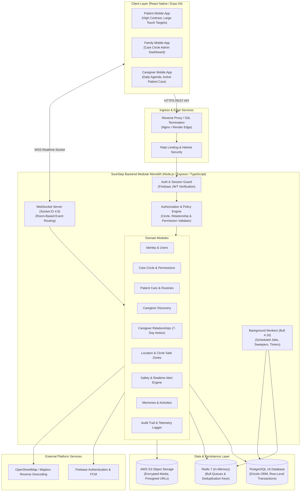
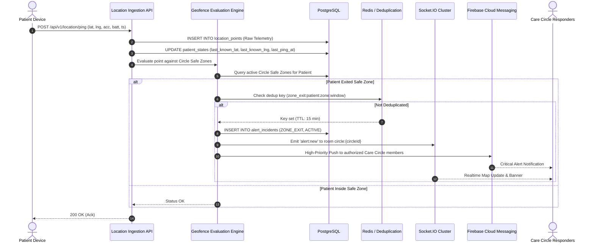
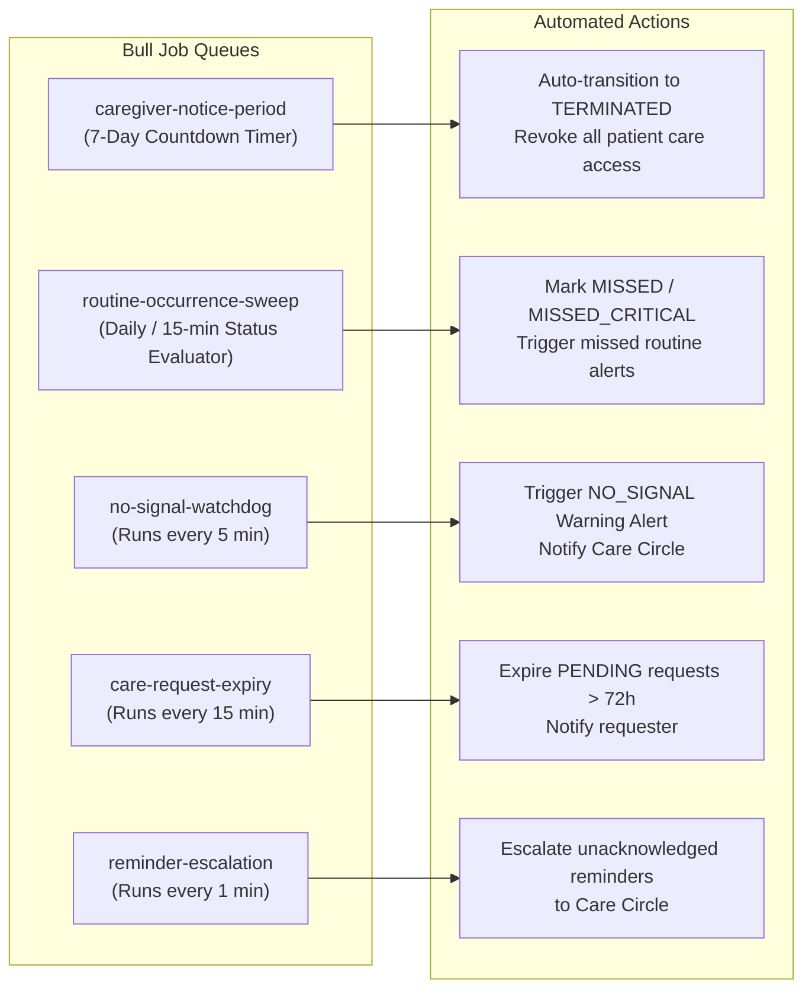
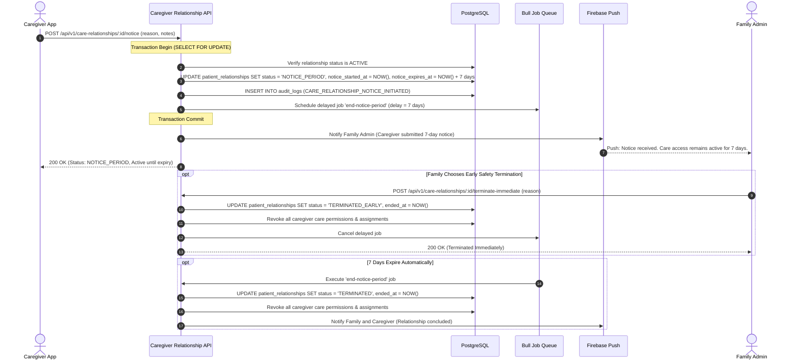

# SureStep V1 — System Architecture Document

**Version:** 1.0  
**Status:** Approved Technical Architecture  
**Baseline Requirements:** `docs/requirements/V1_REQUIREMENT.md`  
**Baseline Workflows:** `docs/workflows/01-IDENTITY.md` through `11-ACCOUNT-AND-SETTINGS.md`  
**Codebase Audit:** `docs/audits/CODEBASE_AUDIT.md`

---

## 1. Architectural Principles & System Context

SureStep is designed as a **Modular Monolith** backend paired with a **React Native / Expo mobile application**. The system delivers high reliability, sub-second safety alerting, and deterministic authorization without the operational complexity of microservices.

### 1.1 Core Architectural Principles
1. **Safety-First Determinism:** Critical alerts (SOS, Safe Zone breaches, overdue critical medications) bypass caching and queues to guarantee immediate delivery via FCM High-Priority Push and WebSocket dispatch.
2. **Four-Tier Decoupled Authority:** Access control is strictly decoupled into distinct layers:
   $$\text{Circle Membership} \neq \text{Caregiver Relationship} \neq \text{Patient Assignment} \neq \text{Care Permission}$$
   No entity inherits access implicitly by mere association.
3. **No Clinical Interpretation / No ML Scoring:** The platform stores and surfaces raw telemetry and observational care notes only. Cognitive scoring, MMSE tests, and predictive diagnostic models are strictly prohibited in V1 runtime.
4. **Wrong-Patient Prevention:** Every request affecting a patient requires explicit patient context (`patientId`) and is validated against the active Care Circle and assignment records.
5. **Audit Traceability:** All safety-critical mutations (boundary edits, permission delegations, relationship terminations, alert resolutions) produce immutable append-only audit entries.

---

## 2. High-Level System Architecture



---

## 3. Major System Components & Responsibilities

### 3.1 Client Layer (Mobile Application)
Built using React Native (0.81.5), Expo SDK (54), and TypeScript:
- **Role-Based Experience Isolation:**
  - **Patient Interface:** Accessible, high-contrast, large-touch interface. Emits continuous background location pings, renders memory lane cards, displays scheduled audio/visual routine prompts, and provides a single-tap SOS.
  - **Family Interface:** Care Circle administration, member invitations, delegatable permission assignment, Circle Safe Zone creation, Caregiver discovery/search, care request issuance, and alert acknowledgment.
  - **Caregiver Interface:** Professional profile setup (7 required fields), schedule and patient assignment views, routine execution log sign-offs, and 7-day notice period initiation.
- **Offline Resiliency & Local Cache:** Local notification triggers for medication and routine reminders if offline; location buffer queue that syncs when network connectivity returns.

### 3.2 Ingress & Security Boundary
- **SSL Termination & CORS:** HTTPS (TLS 1.3) enforced. Strict CORS limiting access to verified app origins.
- **Rate Limiting:** IP and user-based limits (`express-rate-limit`) preventing brute force attacks on SMS OTP verification and location ingestion flood attacks.
- **Security Headers:** `helmet` middleware enforcing strict Content Security Policy, XSS filtering, frameguard, and referrer policy.

### 3.3 Backend Modular Monolith
A unified, single-deployment Node.js process organized into decoupled domain modules:

| Module | Core Responsibility | Workflow Traced |
| :--- | :--- | :--- |
| **`modules/auth`** | Firebase JWT verification, user provisioning, session invalidation, account deactivation/deletion cascades. | 01-IDENTITY, 11-ACCOUNT-AND-SETTINGS |
| **`modules/circle`** | Care Circle lifecycle, ownership transfer, member invites, granular permission delegations (`Manage Member Permissions`, `Manage Caregiver Relationships`, `Search/Request Caregivers`, `Manage Patient Memories`). | 03-CARE-CIRCLE |
| **`modules/patient-care`** | Patient profiles, routine definitions, daily occurrence generation, medication schedules, completion logs, Wrong-Patient validation. | 02-PATIENT-ONBOARDING, 04-PATIENT-CARE |
| **`modules/discovery`** | Caregiver searchable profiles (7 mandatory fields), geocoded radius queries, platform misconduct reporting. | 05-CAREGIVER-DISCOVERY |
| **`modules/care-relationships`** | Care request proposals, 7-day `Notice Period` state machine, immediate safety terminations, audit trail logging. | 06-CAREGIVER-RELATIONSHIP |
| **`modules/location`** | Telemetry ingestion, historical trail queries, Care Circle Safe Zone definitions (circular and polygon), multi-patient monitoring attachment. | 08-LOCATION-AND-SAFE-ZONES |
| **`modules/alerts`** | Geofence breach detection, 15-minute signal loss escalation, deduplication, alert acknowledgment, responder routing. | 07-SAFETY, 10-NOTIFICATIONS-AND-ACTIVITY |
| **`modules/memories`** | Patient memory cards, voice notes, photo albums, default connected-person audience scoping. | 09-MEMORIES-AND-ACTIVITIES |
| **`modules/audit`** | Append-only immutable system ledger for safety events, permission changes, and lifecycle transitions. | 10-NOTIFICATIONS-AND-ACTIVITY |

---

## 4. Subsystems Architecture

### 4.1 Authentication & Authorization Subsystems

#### Authentication Boundary
- Mobile clients authenticate with Firebase Phone Auth via SMS OTP.
- The resulting Firebase ID token (JWT) is sent in the `Authorization: Bearer <token>` header.
- The backend verifies the token with `firebase-admin`, extracts the `firebase_uid`, and loads the active user record from PostgreSQL.
- Revoked tokens, deleted accounts, or deactivated users result in immediate `401 Unauthorized`.

#### Authorization Policy Engine
The authorization engine enforces the 4-tier model via composable middleware:
```typescript
interface PolicyContext {
  actorId: string;
  actorRole: 'PATIENT' | 'FAMILY' | 'CAREGIVER';
  circleId?: string;
  patientId?: string;
  requiredPermission?: CirclePermission;
}
```
1. **Patient Self-Access:** A patient can access their own profile, routines, memories, and emergency triggers. They cannot access other patients or administrative circle controls.
2. **Circle Owner Authority:** The primary Family Member who created the Care Circle holds full administrative authority, including permission delegation and Circle deletion.
3. **Delegated Circle Authority:** A member holding `Manage Member Permissions` can grant or revoke other delegatable permissions.
4. **Caregiver Scope:** Professional caregivers access only patients explicitly assigned to them under an active or notice-period relationship. Revocation or termination severs access immediately.

---

### 4.2 Location & Geofencing Subsystem



#### Key Location Invariants:
1. **Circle-Owned Zones:** Safe zones are configured at the Care Circle level (`care_circle_id`), allowing family administrators to monitor one or multiple patients residing in or visiting the same home or day center.
2. **Anti-Flapping Filter:** A buffer of consecutive exit points ($N \ge 2$) or accuracy validation ($accuracy \le 30\text{m}$) prevents false alerts caused by GPS multipath reflections.
3. **No-Signal Watchdog:** Background worker checks for patients with no telemetry ping for $> 15\text{ minutes}$, automatically escalating to `NO_SIGNAL` warning.

---

### 4.3 Notification & Realtime Subsystem

SureStep implements a dual-channel notification architecture:
1. **WebSocket Server (`Socket.IO 4.8`):**
   - Provides sub-second updates for in-app users.
   - Rooms are organized strictly by authenticated scope:
     - `user:{userId}` — Personal notifications and permission changes.
     - `circle:{circleId}` — Circle-wide alerts, safe zone breaches, and member joins.
     - `patient:{patientId}` — Realtime tracking trail and routine completions.
2. **Push Notifications (`Firebase Cloud Messaging - FCM`):**
   - High-priority data messages for SOS triggers and safe zone exits (wakes background app, plays high-importance alert tone).
   - Standard notifications for routine reminders, care request proposals, and daily digests.
   - Device tokens are registered in `device_registry` and pruned on `UNREGISTERED` errors.

---

### 4.4 Background Jobs Subsystem (`Bull 4.16` + Redis)

Background workloads are isolated into deterministic, single-purpose Bull queues:



1. **`caregiver-notice-period`:** When a caregiver initiates termination, a delayed job is scheduled for exactly $7 \times 24\text{ hours}$. Upon execution, it transitions the relationship to `TERMINATED`, revokes all care permissions, and notifies the Care Circle.
2. **`routine-occurrence-sweep`:** Sweeps upcoming and overdue routine tasks. If a critical medication is not signed off within 60 minutes, an alert incident is raised.
3. **`no-signal-watchdog`:** Evaluates `last_ping_at` across all active patients and raises `NO_SIGNAL` alerts when telemetry stops.
4. **`care-request-expiry`:** Auto-expires unanswered care requests after 72 hours.
5. **Prohibited Job Exclusion:** The legacy `weeklyReportQueue` computing MMSE/cognitive trend scores is permanently removed from the system.

---

### 4.5 File & Object Storage Subsystem

- **Storage Provider:** AWS S3 (or S3-compatible cloud storage) with server-side encryption (`AES-256`).
- **Access Pattern:** Private bucket with **Pre-Signed URLs** for both uploads and downloads:
  1. Client requests upload ticket: `POST /api/v1/media/upload-url` (validates MIME type, file size $\le 10\text{MB}$, and entity association).
  2. Server generates pre-signed PUT URL (TTL: 15 minutes).
  3. Client uploads directly to S3.
  4. Media records are stored in PostgreSQL with key references.
  5. Download requests verify caller authorization (e.g., patient memory audience) before returning a short-lived pre-signed GET URL (TTL: 60 minutes).

---

### 4.6 Audit & Telemetry Logging Subsystem

- All mutations affecting safety, access, and relationships are written synchronously to an append-only `audit_logs` table.
- **Log Entry Structure:**
  - `id`: UUIDv7 (time-sortable)
  - `actor_id`: User initiating action
  - `actor_role`: Role at time of action
  - `circle_id`: Context Care Circle
  - `patient_id`: Context Patient
  - `action`: Specific domain action (e.g., `CARE_RELATIONSHIP_NOTICE_INITIATED`, `PERMISSION_DELEGATED`, `SAFE_ZONE_BREACHED`)
  - `entity_type` & `entity_id`: Target entity
  - `previous_state` & `new_state`: JSON snapshot of change
  - `ip_address` & `user_agent`: Network origin
  - `created_at`: Immutable server timestamp
- The audit table has no `UPDATE` or `DELETE` grants in application database credentials, ensuring tamper-evident preservation.

---

## 5. End-to-End Request & Data Flows

### 5.1 Caregiver Notice Period Lifecycle Flow



---

## 6. Architecture Quality Attributes

| Quality Attribute | Architectural Strategy | Verification Metric |
| :--- | :--- | :--- |
| **Reliability & Availability** | Stateless application tier; horizontal replica scaling; PostgreSQL connection pooling with health probes; Redis queue persistence. | 99.9% uptime; zero alert loss during restarts. |
| **Alert Latency** | Dual-channel delivery: Socket.IO realtime emit to connected apps; FCM High-Priority push payloads for background devices. | Sub-2-second end-to-end alert delivery from ingestion to device alert tone. |
| **Data Integrity** | Transactional row-level locking (`SELECT ... FOR UPDATE`) on relationship and permission mutations; foreign key cascades. | Zero orphaned permissions; no concurrent double-booking of caregivers. |
| **Wrong-Patient Prevention** | Server-side validation enforcing that all patient-bound operations include verified `patientId` associated with caller's active Circle. | 100% rejection of cross-patient or unassigned caregiver queries. |
| **Security & Privacy** | AES-256 S3 storage; Firebase phone authentication; RBAC + ABAC authorization middleware; short-lived media URLs. | Zero direct object reference vulnerabilities; no public S3 buckets. |

