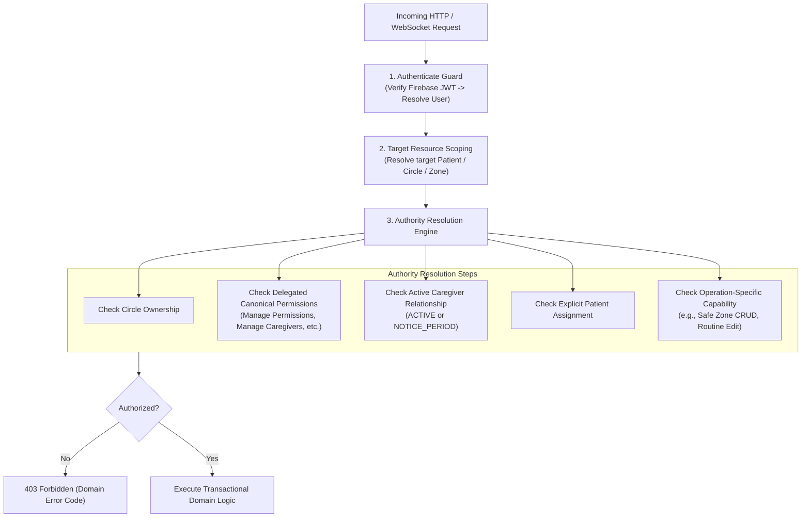
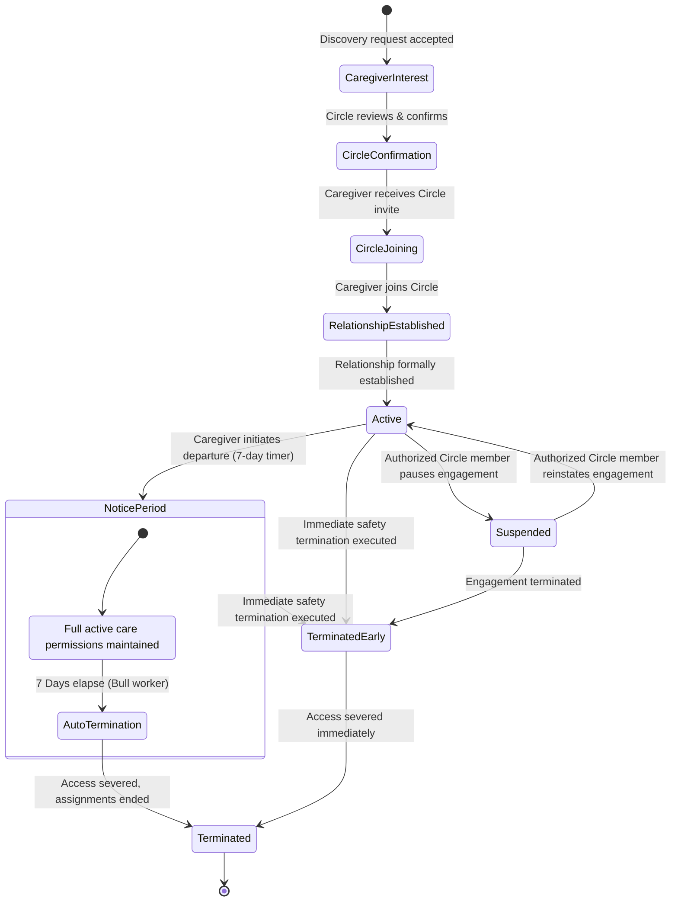
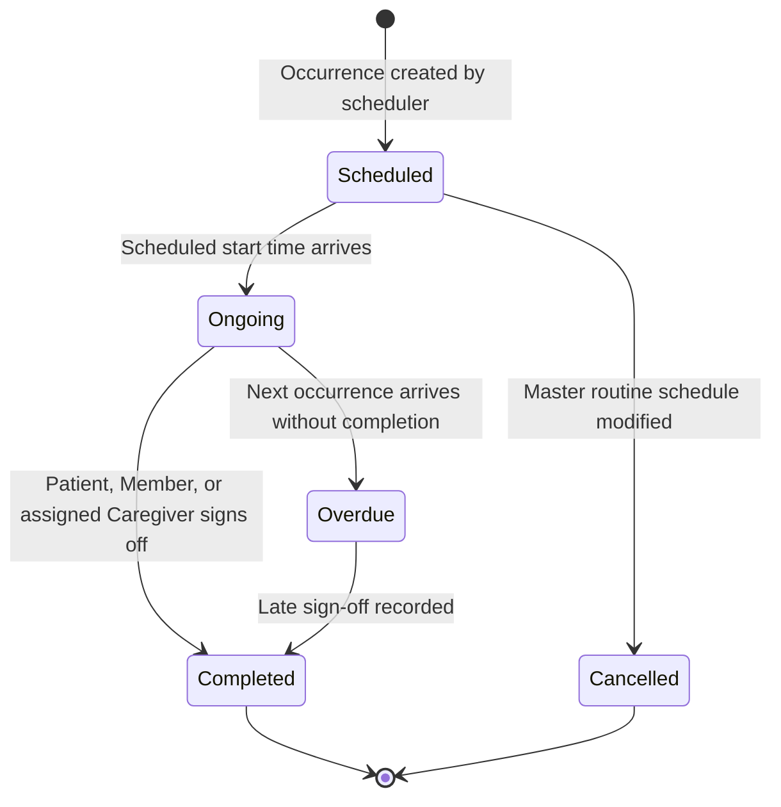
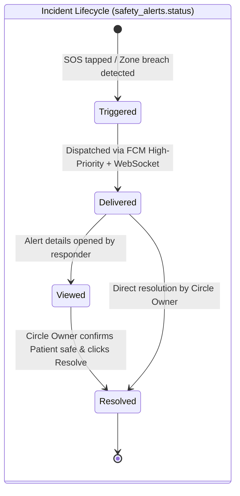
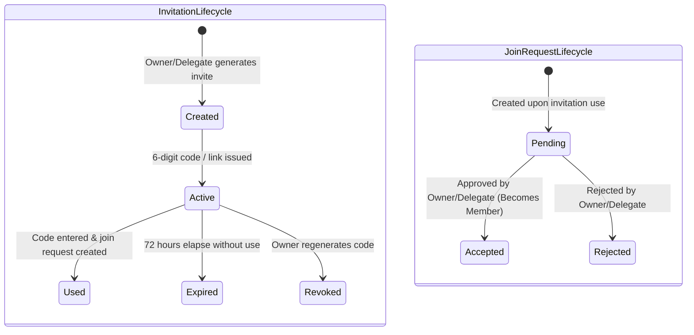
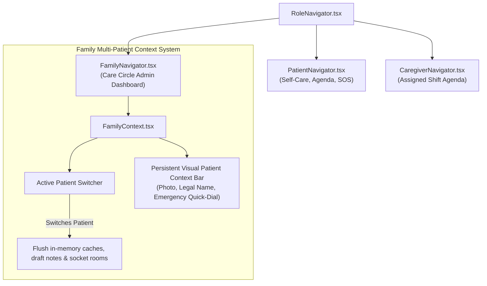
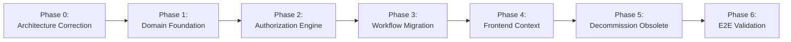

# SureStep V1 — Authoritative Target Architecture

**Document:** `docs/architecture/TARGET_ARCHITECTURE.md`  
**Version:** 1.0 (Authoritative Implementation Blueprint)  
**Date:** October 28, 2026  
**Status:** Architecture Baseline — Product Decisions Finalized  
**Baseline Requirements:** `docs/requirements/V1_REQUIREMENT.md`  
**Baseline Workflows:** `docs/workflows/01-IDENTITY.md` through `11-ACCOUNT-AND-SETTINGS.md`  
**Superseded Baseline:** `docs/audits/ARCHITECTURE_AUDIT.md` (superseded where conflicting)

---

## 1. Source of Truth & Architectural Precedence

This document serves as the **authoritative technical implementation blueprint** for the SureStep V1 engineering phase. It bridges the finalized product specifications and the existing codebase.

### 1.1 Precedence Hierarchy
When resolving architectural questions or ambiguities, the strict order of precedence is:
1. `docs/requirements/V1_REQUIREMENT.md`
2. Core Workflows: `docs/workflows/01-IDENTITY.md` through `11-ACCOUNT-AND-SETTINGS.md`
3. Current Codebase (`SureStep/` and `surestep-backend/`)
4. Previous Audit (`docs/audits/ARCHITECTURE_AUDIT.md`) — *non-authoritative where conflicting*

### 1.2 Corrections to Previous Architecture Audit
This blueprint explicitly overrides and corrects several assumptions introduced in the previous architecture audit:
1. **Care Circle Ownership:** A Care Circle is owned by a **User** (Family Member OR Professional Caregiver), not exclusively a Family Member. `Circle Owner = Family Member` is **not** a domain invariant. A Patient cannot create a Circle. Ownership can later be transferred to an eligible non-Patient member.
2. **Care Circle as Access/Coordination Container:** The Care Circle is an **access and coordination boundary**, not the owner of Patient data. Patient clinical profiles, emergency contacts, and personal settings remain Patient-associated. Circle deletion terminates Circle-derived configuration/access while preserving Patient-owned data.
3. **No Arbitrary Entity Counts:** Persistence entities are derived strictly from domain ownership, lifecycle states, authorization boundaries, query patterns, and transactional safety—not an arbitrary table count.
4. **Canonical Permission Boundaries:** Delegatable canonical permissions are strictly limited to those established by requirements: `Manage Member Permissions`, `Manage Caregiver Relationships`, `Search/Request Caregivers`, and `Manage Patient Memories`. Operational capabilities (e.g. modifying routines or safe zones) are evaluated at the operation/resource level rather than inventing unratified permission taxonomies.
5. **Routine Lifecycle Correction:** Routines do **not** use `PENDING / SNOOZED / MISSED / MISSED_CRITICAL / BEHIND`. The finalized V1 model is:
   $$\text{Scheduled} \longrightarrow \text{Ongoing} \longrightarrow \text{Completed}$$
   When a new occurrence arrives while an ongoing occurrence is incomplete:
   $$\text{Ongoing} \longrightarrow \text{Overdue}$$
   There is **no Skip state** and **no automatic emergency alert** generated solely because a routine becomes overdue.
6. **Safe Zone Architecture:** Safe Zones belong to the Care Circle and support **simple circular radius boundaries only**. Polygonal zones (`POLYGON`, `polygon_coords`) are **not** part of V1.
7. **Safety Alert Lifecycle & Responder Decoupling:** Safety alerts follow their own incident lifecycle:
   $$\text{Triggered} \longrightarrow \text{Delivered / Active} \longrightarrow \text{Viewed} \longrightarrow \text{Resolved}$$
   Responder actions (such as selecting `I'm Responding`) are recorded in an associated response ledger (`safety_alert_responses`) rather than a mutually exclusive alert ownership state. Multiple authorized responders may respond without blocking each other. There is **no False Alarm / False Positive state**, no automatic escalation chain, no automatic emergency dispatch, and **no automatic resolution upon returning to a Safe Zone**. `I'm Responding` does not resolve an incident.
8. **Account Deletion:** Account deletion requires explicit dependency resolution (Circle ownership transfer/deletion, relationship termination) and atomic session revocation. Unratified cooling-off periods (e.g. "14-day cooling off") are removed from the technical specification.
9. **Non-Diagnostic Telemetry Boundary:** Clinical cognitive scoring, MMSE tests, and dementia prediction modules currently present in the codebase are marked obsolete and excluded from the V1 runtime.

---

## 2. Core Architectural Principles & Foundational Invariants

```mermaid
flowchart TD
    subgraph IdentityLayer["1. Identity Layer"]
        U["User (Account)"]
        P["Patient Profile (Patient-Associated)"]
        U --- P
    end

    subgraph CoordinationLayer["2. Coordination & Tenancy Layer"]
        CC["Care Circle (Coordination Container)"]
        U -->|owns (Family or Caregiver)| CC
        CCM["Circle Membership"]
        CC --> CCM
        PCA["Patient-Circle Association (Multi-Patient)"]
        CC --> PCA
        PCA --> P
    end

    subgraph DelegationLayer["3. Authority & Engagement Layer"]
        CP["Circle Permissions (Delegated)"]
        CCM --> CP
        CR["Caregiver Relationship (Contractual)"]
        CC --> CR
        PA["Patient Assignment (Explicit)"]
        CR --> PA
        PA --> P
    end


    subgraph OperationLayer["4. Resource & Telemetry Layer"]
        SZ["Circle Safe Zones (Circular Only)"]
        CC --> SZ
        RD["Routine Definitions (Master Plan)"]
        P --> RD
        RO["Routine Occurrences (Scheduled / Ongoing / Completed)"]
        RD --> RO
        AL["Safety Alerts (SOS / Breach)"]
        P --> AL
        MEM["Patient Memories (Connected Care Audience)"]
        P --> MEM
    end
```

### Invariant 1: Multi-Tier Decoupled Authority
Access is strictly evaluated through decoupled tiers:
$$\text{Circle Membership} \neq \text{Patient Association} \neq \text{Caregiver Relationship} \neq \text{Patient Assignment} \neq \text{Care Access}$$
- Joining a Circle does **not** grant access to Patient health data, location, routines, or memories.
- An Active Caregiver Relationship does **not** grant access to a Patient without an explicit, active **Patient Assignment**.
- A Circle may contain multiple Patients; a Caregiver may be assigned to a subset of Patients within the Circle. V1 does not support cross-Circle caregiver assignments.
- Memories are visible strictly to the Patient's connected care audience (the Patient, active Circle members connected to that Patient, and assigned Professional Caregivers). Arbitrary non-Circle/external contacts are not granted memory access.
- Safe Zone management and safety alert resolution are strictly **Circle Owner only** in V1; neither capability is delegatable.

### Invariant 2: Care Circle as Access Boundary, Not Data Owner
- The Care Circle coordinates care, holds Safe Zones, and issues invites.
- Patient health records, medical diagnoses, emergency contacts, and personal preferences belong to the **Patient Profile**.
- When a Circle is deleted, Circle-derived configuration (memberships, delegations, assignments, safe zones) terminates, but Patient-owned profiles and SOS contacts are **not** deleted.

### Invariant 3: Care Circle Ownership
- A Care Circle is owned by a **User** who may hold the role of `FAMILY` or `CAREGIVER`.
- A Patient cannot create or own a Care Circle.
- Ownership transfer is an Owner-only operation and can only target an eligible, non-Patient Circle member.

### Invariant 4: Non-Diagnostic Telemetry Boundary
The system persists raw observational and telemetry data only:
- Raw GPS coordinates, horizontal accuracy, and timestamps.
- Routine occurrence sign-offs, notes, and responder identities.
- Voluntary activity completions, attempt counts, and session durations.
The system **must not** compute, persist, or expose:
- MMSE or cognitive test scores.
- Dementia progression ratings or cognitive decline percentages.
- Algorithmic diagnostic recommendations.

---

## 3. Domain Model & Persistence Architecture

Persistence entities are derived strictly from domain requirements, lifecycles, and query boundaries. Every proposed table maps to an explicit operational need.

```mermaid
erDiagram
    USERS ||--o{ PATIENT_PROFILES : "extends (1:1 if PATIENT)"
    USERS ||--o{ FAMILY_PROFILES : "extends (1:1 if FAMILY)"
    USERS ||--o{ CAREGIVER_PROFILES : "extends (1:1 if CAREGIVER)"
    USERS ||--o{ DEVICE_REGISTRY : "registers FCM tokens"
    
    USERS ||--o{ CARE_CIRCLES : "owns (Family or Caregiver)"
    CARE_CIRCLES ||--o{ CARE_CIRCLE_MEMBERS : "contains"
    USERS ||--o{ CARE_CIRCLE_MEMBERS : "participates as"
    
    CARE_CIRCLES ||--o{ PATIENT_CIRCLE_ASSOCIATIONS : "monitors"
    USERS ||--o{ PATIENT_CIRCLE_ASSOCIATIONS : "patient link"
    
    CARE_CIRCLES ||--o{ CIRCLE_INVITATIONS : "issues"
    CARE_CIRCLES ||--o{ CIRCLE_JOIN_REQUESTS : "receives"
    USERS ||--o{ CIRCLE_JOIN_REQUESTS : "applicant"
    
    CARE_CIRCLE_MEMBERS ||--o{ CIRCLE_PERMISSIONS : "holds"
    
    CARE_CIRCLES ||--o{ CAREGIVER_REQUESTS : "initiates"
    USERS ||--o{ CAREGIVER_REQUESTS : "target caregiver"
    
    CARE_CIRCLES ||--o{ CAREGIVER_RELATIONSHIPS : "establishes"
    USERS ||--o{ CAREGIVER_RELATIONSHIPS : "caregiver"
    
    CAREGIVER_RELATIONSHIPS ||--o{ PATIENT_ASSIGNMENTS : "grants scope via"
    USERS ||--o{ PATIENT_ASSIGNMENTS : "assigned patient"
    
    USERS ||--o{ ROUTINE_DEFINITIONS : "patient care plan"
    ROUTINE_DEFINITIONS ||--o{ ROUTINE_OCCURRENCES : "schedules"
    ROUTINE_OCCURRENCES ||--o| ROUTINE_COMPLETIONS : "signed with"
    
    CARE_CIRCLES ||--o{ SAFE_ZONES : "owns (circular only)"
    SAFE_ZONES ||--o{ SAFE_ZONE_MONITORS : "attaches"
    USERS ||--o{ SAFE_ZONE_MONITORS : "monitored patient"
    
    USERS ||--o{ LOCATION_OBSERVATIONS : "patient telemetry"
    
    USERS ||--o{ SAFETY_ALERTS : "patient incident"
    SAFETY_ALERTS ||--o{ SAFETY_ALERT_RESPONSES : "responder logs"
    
    USERS ||--o{ MEMORIES : "patient memory lane"
    USERS ||--o{ ACTIVITY_ATTEMPTS : "voluntary engagement"
    
    USERS ||--o{ NOTIFICATIONS : "inbox"
    USERS ||--o{ AUDIT_RECORDS : "actor"
```



### 3.1 Identity & User Profiles Domain

#### `users`
- **Responsibility:** Global authentication identity and primary platform role.
- **Fields:** `id` (UUIDv7, PK), `firebase_uid` (VARCHAR, UNIQUE), `phone` (VARCHAR, E.164, UNIQUE), `name` (VARCHAR), `role` (`PATIENT`, `FAMILY`, `CAREGIVER`), `preferred_language` (VARCHAR, DEFAULT 'en'), `avatar_url` (TEXT), `is_active` (BOOLEAN, DEFAULT TRUE), `created_at`, `updated_at`, `deleted_at`.
- **Ownership & Boundary:** Top-level global entity.

#### `patient_profiles`
- **Responsibility:** Patient clinical, living arrangement, safety risk, and emergency profile data. Fulfills the patient care domain concepts from `02-PATIENT-ONBOARDING.md` alongside `users`.
- **Fields:**
  - `user_id` (UUID, PK, FK $\to$ `users.id`, CASCADE)
  - `preferred_name` (VARCHAR, optional preferred display name)
  - `date_of_birth` (DATE, required)
  - `gender` (VARCHAR, required)
  - `home_address_or_city` (VARCHAR, required location)
  - `living_arrangement` (VARCHAR, required living situation)
  - `dementia_severity` (VARCHAR, required severity assessment)
  - `assistance_required_activities` (TEXT[], required list of daily assistance needs)
  - `wandering_risk_status` (VARCHAR, required safety/wandering risk level)
  - `emergency_contact_name` (VARCHAR, required)
  - `emergency_contact_phone` (VARCHAR, required contact details)
  - `emergency_contact_relationship` (VARCHAR, required relationship to patient)
  - `emergency_contact_user_id` (UUID, NULLable, optional account linking FK $\to$ `users.id`)
  - `household_context` (TEXT, optional living/household environment notes)
  - `communication_preferences` (TEXT, optional patient communication guidance)
  - `other_health_conditions` (TEXT[], optional health/medical context)
  - `medications_summary` (TEXT, optional current medication information)
  - `additional_safety_concerns` (TEXT, optional specific safety warnings)
  - `onboarding_assisted` (BOOLEAN, DEFAULT FALSE, indicates if onboarding was completed with helper assistance)
  - `care_mode` (`SELF`, `ASSISTED`, DEFAULT `ASSISTED`)
  - `self_routine_management_enabled` (BOOLEAN, DEFAULT FALSE)
  - `updated_at` (TIMESTAMPTZ)
- **Domain Mapping Notes:** Account-level identity concepts (Legal Name `users.name`, Preferred Language `users.preferred_language`, Profile Photo `users.avatar_url`) reside in `users`. All clinical, care, and emergency profile concepts defined in `02-PATIENT-ONBOARDING.md` reside in `patient_profiles`. Prototype fields (`allergies`, `comfort_items`, `known_triggers`) not present in the finalized onboarding workflow have been removed.
- **Ownership:** Patient-associated. Retained when a Circle is deleted.

#### `caregiver_profiles`
- **Responsibility:** Professional credentials and discovery directory attributes.
- **Fields:** `user_id` (UUID, PK, FK $\to$ `users.id`, CASCADE), `years_of_experience` (INTEGER), `languages_spoken` (TEXT[]), `service_city` (VARCHAR), `service_radius_km` (INTEGER), `care_capabilities` (TEXT[]), `availability_type` (VARCHAR), `hourly_rate` (NUMERIC), `is_discoverable` (BOOLEAN, DEFAULT FALSE), `has_dementia_training` (BOOLEAN, DEFAULT FALSE), `bio` (TEXT), `updated_at`.
- **Validation Rule:** `is_discoverable` cannot be set to `TRUE` until all 7 required fields are non-null. Credentials and training are self-reported; no verification badge exists in V1.

---

### 3.2 Care Circle & Access Container Domain

#### `care_circles`
- **Responsibility:** Top-level coordination and access container.
- **Fields:** `id` (UUIDv7, PK), `name` (VARCHAR), `owner_id` (UUID, FK $\to$ `users.id`, RESTRICT), `created_at`, `updated_at`, `terminated_at` (TIMESTAMPTZ, NULLable).
- **Ownership:** Owned by a `User` (Family Member or Professional Caregiver).

#### `care_circle_members`
- **Responsibility:** Participation bridge between a User and a Care Circle.
- **Fields:** `id` (UUIDv7, PK), `circle_id` (UUID, FK $\to$ `care_circles.id`, CASCADE), `user_id` (UUID, FK $\to$ `users.id`, RESTRICT), `role_in_circle` (`OWNER`, `MEMBER`, `CAREGIVER`), `joined_at` (TIMESTAMPTZ).
- **Constraints:** `UNIQUE (circle_id, user_id)`.
- **Account Deletion Invariant:** `user_id` is `RESTRICT`. An account with active Circle memberships cannot be deleted at the database boundary without the application explicitly revoking the memberships and resolving access dependencies (`01-IDENTITY.md` §6).

#### `patient_circle_associations`
- **Responsibility:** Maps Patients to the Care Circle coordinating their care.
- **Fields:** `id` (UUIDv7, PK), `circle_id` (UUID, FK $\to$ `care_circles.id`, CASCADE), `patient_id` (UUID, FK $\to$ `users.id`, RESTRICT), `associated_at` (TIMESTAMPTZ), `associated_by` (UUID, FK $\to$ `users.id`, RESTRICT).
- **Constraints:** `UNIQUE (circle_id, patient_id)`. Supports multiple Patients per Circle.
- **Account Deletion Invariant:** `patient_id` is `RESTRICT`. Patient account deletion cannot silently cascade-delete or orphan active Circle-based care, monitoring, and relationships. All care dependencies and Circle associations must be explicitly resolved before patient account deletion completes (`01-IDENTITY.md` §6).

#### `circle_invitations`
- **Responsibility:** 6-digit code and link-based onboarding invitations.
- **Fields:** `id` (UUIDv7, PK), `circle_id` (UUID, FK $\to$ `care_circles.id`, CASCADE), `code` (VARCHAR(6), UNIQUE), `created_by` (UUID, FK $\to$ `users.id`, RESTRICT), `status` (`ACTIVE`, `USED`, `EXPIRED`, `REVOKED`), `expires_at` (TIMESTAMPTZ), `used_at` (TIMESTAMPTZ), `created_at`.
- **Lifecycle Rule:** Status transitions to `USED` upon successful creation of a `circle_join_request`, **not** upon membership approval.

#### `circle_join_requests`
- **Responsibility:** Tracks applicant approval pipeline following invitation use.
- **Fields:** `id` (UUIDv7, PK), `circle_id` (UUID, FK $\to$ `care_circles.id`, CASCADE), `user_id` (UUID, FK $\to$ `users.id`, RESTRICT), `invitation_id` (UUID, FK $\to$ `circle_invitations.id`, RESTRICT), `status` (`PENDING`, `ACCEPTED`, `REJECTED`), `reviewed_by` (UUID, NULLable, FK $\to$ `users.id`, RESTRICT), `reviewed_at` (TIMESTAMPTZ), `created_at`.
- **Account Deletion Invariant:** `user_id` is `RESTRICT`. Pending join requests must be explicitly cancelled/invalidated by the account deletion workflow prior to user removal.

#### `circle_permissions`
- **Responsibility:** Stores granular delegatable permissions granted to a Circle Member.
- **Fields:** `id` (UUIDv7, PK), `member_id` (UUID, FK $\to$ `care_circle_members.id`, CASCADE), `permission_name` (VARCHAR), `granted_by` (UUID, FK $\to$ `users.id`), `granted_at` (TIMESTAMPTZ).
- **Canonical Delegatable Permissions:**
  1. `Manage Member Permissions` (Meta-delegation)
  2. `Manage Caregiver Relationships` (Contractual lifecycle & assignments)
  3. `Search/Request Caregivers` (Discovery & proposals)
  4. `Manage Patient Memories` (Content curation)
- **Constraints:** `UNIQUE (member_id, permission_name)`.

---

### 3.3 Caregiver Relationship & Assignment Domain

#### `caregiver_requests`
- **Responsibility:** Discovery proposals and initial interest exchanges.
- **Fields:** `id` (UUIDv7, PK), `circle_id` (UUID, FK $\to$ `care_circles.id`), `patient_id` (UUID, FK $\to$ `users.id`), `requester_id` (UUID, FK $\to$ `users.id`), `caregiver_id` (UUID, FK $\to$ `users.id`), `status` (`PENDING`, `CAREGIVER_INTERESTED`, `ACCEPTED`, `DECLINED`, `WITHDRAWN`, `CANCELLED`), `proposed_rate` (NUMERIC), `schedule_type` (VARCHAR), `start_date` (DATE), `notes` (TEXT), `created_at`, `responded_at`.
- **Invariants:**
  - Acceptance of a request expresses availability/interest only; it does **not** create an active caregiver relationship, does not add the caregiver to the Care Circle, and does not grant Patient care access.
  - V1 deliberately leaves care request expiration undefined. Pending requests remain pending until explicitly acted upon (`CAREGIVER_INTERESTED`, `ACCEPTED`, `DECLINED`, `WITHDRAWN`, `CANCELLED`). No automated timeout or expiry transition exists.

#### `caregiver_relationships`
- **Responsibility:** Formal contractual engagement between Care Circle and Caregiver.
- **Fields:** `id` (UUIDv7, PK), `circle_id` (UUID, FK $\to$ `care_circles.id`), `caregiver_id` (UUID, FK $\to$ `users.id`), `status` (`RELATIONSHIP_ESTABLISHED`, `ACTIVE`, `SUSPENDED`, `NOTICE_PERIOD`, `TERMINATED`), `notice_started_at` (TIMESTAMPTZ), `notice_expires_at` (TIMESTAMPTZ), `termination_reason` (VARCHAR), `termination_notes` (TEXT), `ended_at` (TIMESTAMPTZ), `created_at`.
- **Notice Period Rule:** Notice period lasts exactly 7 days ($7 \times 24\text{ hours}$). Active care access remains in effect. The Care Circle cannot decline the departure.

#### `patient_assignments`
- **Responsibility:** Explicit mapping of an active Caregiver to specific Patient(s).
- **Fields:** `id` (UUIDv7, PK), `relationship_id` (UUID, FK $\to$ `caregiver_relationships.id`, CASCADE), `patient_id` (UUID, FK $\to$ `users.id`, RESTRICT), `assigned_by` (UUID, FK $\to$ `users.id`, RESTRICT), `assigned_at` (TIMESTAMPTZ), `is_active` (BOOLEAN, DEFAULT TRUE).
- **Constraints:** `UNIQUE (relationship_id, patient_id)`. Independently revocable.
- **Account Deletion Invariant:** `patient_id` is `RESTRICT`. Deleting a patient account cannot silently cascade-delete active caregiver assignments. Caregiver assignments must be explicitly terminated prior to patient account deletion (`01-IDENTITY.md` §6).

---

### 3.4 Patient Care & Routine Subsystem Domain

#### `routine_definitions`
- **Responsibility:** Master template for daily recurring care tasks and medications.
- **Fields:** `id` (UUIDv7, PK), `patient_id` (UUID, FK $\to$ `users.id`, CASCADE), `title` (VARCHAR), `category` (`MEDICATION`, `MEAL`, `EXERCISE`, `HYGIENE`, `APPOINTMENT`), `description` (TEXT), `schedule_pattern` (JSONB), `is_active` (BOOLEAN, DEFAULT TRUE), `created_by` (UUID), `created_at`, `updated_at`.
- **Authorization:** Managed strictly by an authorized Family Member in the Circle coordinating the Patient's care plan, or a capable Patient (Self mode or Assisted mode with Routine Management enabled). Circle ownership alone does not confer routine-definition CRUD authority. Professional Caregivers—regardless of whether they are a Circle member, assigned caregiver, or the Circle Owner—must **not** create, edit, pause, resume, or delete routine definitions in V1; caregivers participate in care strictly by completing assigned routine occurrences.

#### `routine_occurrences`
- **Responsibility:** Individual scheduled task instances generated from definitions.
- **Fields:** `id` (UUIDv7, PK), `routine_id` (UUID, FK $\to$ `routine_definitions.id`, CASCADE), `patient_id` (UUID, FK $\to$ `users.id`), `scheduled_date` (DATE), `scheduled_time` (TIME), `status` (`SCHEDULED`, `ONGOING`, `COMPLETED`, `OVERDUE`, `CANCELLED`), `started_at` (TIMESTAMPTZ), `completed_at` (TIMESTAMPTZ), `created_at`.
- **Authoritative Overdue Rule:**
  - Transition from `SCHEDULED` to `ONGOING` occurs when scheduled time arrives.
  - If the next occurrence arrives while the current occurrence is still `ONGOING`, previous occurrence becomes `OVERDUE`.
  - There is **no Skip state**.
  - Historical completed occurrences are immutable.

#### `routine_completions`
- **Responsibility:** Domain operational history and sign-off record for a routine occurrence (distinct from system-wide immutable audit ledger).
- **Fields:** `id` (UUIDv7, PK), `occurrence_id` (UUID, FK $\to$ `routine_occurrences.id`, CASCADE), `completed_by` (UUID, FK $\to$ `users.id`), `completion_source` (`PATIENT_SELF`, `CAREGIVER_ASSISTED`, `FAMILY`), `notes` (TEXT), `completed_at` (TIMESTAMPTZ).
- **Distinction from Audit Records:** `routine_completions` stores user-facing, domain-level operational history (who signed off, when, and optional care notes) designed for agenda display, care coordination, and family visibility. In contrast, `audit_records` (Section 3.7) is a system-wide, write-only compliance and security ledger capturing low-level actor actions, IP addresses, user agents, and JSON state diffs across all entity mutations.

---

### 3.5 Location & Safe Zone Domain

#### `safe_zones`
- **Responsibility:** Circular geographic geofenced areas owned by the Care Circle.
- **Fields:** `id` (UUIDv7, PK), `circle_id` (UUID, FK $\to$ `care_circles.id`, CASCADE), `name` (VARCHAR), `center_lat` (DOUBLE PRECISION), `center_lng` (DOUBLE PRECISION), `radius_meters` (INTEGER), `is_active` (BOOLEAN, DEFAULT TRUE), `created_by` (UUID), `created_at`, `updated_at`.
- **V1 Invariant:** Circular radius zones only. No polygon boundaries.
- **Authority:** Managed strictly by the **Circle Owner only** in V1 (Create, Edit, Activate, Deactivate, Delete). Non-Owner members cannot manage Safe Zones.

#### `safe_zone_monitors`
- **Responsibility:** Junction table linking Patients to Circle Safe Zones.
- **Fields:** `id` (UUIDv7, PK), `safe_zone_id` (UUID, FK $\to$ `safe_zones.id`, CASCADE), `patient_id` (UUID, FK $\to$ `users.id`, CASCADE), `attached_at` (TIMESTAMPTZ).
- **Constraints:** `UNIQUE (safe_zone_id, patient_id)`.
- **Behavior:** If a Patient leaves the Circle, they are removed from this table. If other Patients remain, the zone stays active. If no Patients remain, monitoring is deactivated.
- **Authority:** Attaching or detaching monitored Patients is strictly **Circle Owner only**.

#### `location_observations`
- **Responsibility:** Raw time-series GPS pings emitted by Patient devices.
- **Fields:** `id` (UUIDv7, PK), `patient_id` (UUID, FK $\to$ `users.id`, CASCADE), `lat` (DOUBLE PRECISION), `lng` (DOUBLE PRECISION), `accuracy_meters` (DOUBLE PRECISION), `altitude_meters` (DOUBLE PRECISION), `battery_pct` (INTEGER), `is_charging` (BOOLEAN), `recorded_at` (TIMESTAMPTZ), `received_at` (TIMESTAMPTZ).
- **Partitioning Strategy `[Architecture Parameter / Implementation Decision]`:** Monthly range partitioning on `recorded_at` for high-throughput scaling.
- **Offline / Stale Telemetry Invariant:** Stale or offline location observations do **not** generate Safe Zone breach alerts. Data synced after an offline period is stored for historical location telemetry/audit, but the system must not reconstruct retrospective breaches or dispatch real-time alerts from old points.

---

### 3.6 Safety & Alert Subsystem Domain

#### `safety_alerts`
- **Responsibility:** Critical safety incident entity (SOS and Safe Zone breaches) tracking the incident's own state lifecycle.
- **Fields:** `id` (UUIDv7, PK), `circle_id` (UUID, FK $\to$ `care_circles.id`), `patient_id` (UUID, FK $\to$ `users.id`), `alert_type` (`SOS_MANUAL`, `ZONE_BREACH`), `status` (`TRIGGERED`, `ACTIVE`, `VIEWED`, `RESOLVED`), `trigger_lat` (DOUBLE PRECISION), `trigger_lng` (DOUBLE PRECISION), `safe_zone_id` (UUID, NULLable), `dedup_key` (VARCHAR, UNIQUE), `triggered_at` (TIMESTAMPTZ), `resolved_at` (TIMESTAMPTZ), `resolved_by` (UUID).
- **Lifecycle Invariant:** Human resolution is required and is strictly **Circle Owner only** in V1 (`resolved_by` must be Circle Owner). Patient returning to a Safe Zone updates telemetry but does **not** auto-resolve the incident.

#### `safety_alert_responses`
- **Responsibility:** Operational responder action records associated with a safety incident, explicitly decoupled from the incident's alert state.
- **Fields:** `id` (UUIDv7, PK), `alert_id` (UUID, FK $\to$ `safety_alerts.id`, CASCADE), `responder_id` (UUID, FK $\to$ `users.id`), `action` (`IM_RESPONDING`, `RESOLVED`), `notes` (TEXT), `created_at` (TIMESTAMPTZ).
- **Rule:** `IM_RESPONDING` records an authorized responder's active engagement and timestamp. It does **not** grant exclusive ownership of the incident, does not transition the alert out of active visibility, and does not block other authorized responders from responding. Multiple responders may record response actions. The incident remains active until the **Circle Owner** explicitly executes `RESOLVED` (resolving an alert is Circle Owner only).

---

### 3.7 Memories, Activities & Governance Domain

#### `memories`
- **Responsibility:** Familiar memory content (photos, short videos, text memories) associated with a Patient to provide comfort and recognition.
- **Fields:** `id` (UUIDv7, PK), `patient_id` (UUID, FK $\to$ `users.id`, CASCADE), `creator_id` (UUID, FK $\to$ `users.id`), `title` (VARCHAR), `media_type` (`PHOTO`, `VIDEO`, `TEXT`), `media_key` (TEXT, NULLable for text-only memories), `caption` (TEXT), `associated_person_id` (UUID, NULLable, FK $\to$ `users.id`), `created_at`, `updated_at`.
- **Visibility (Connected Care Audience Only):** Visible strictly to the Patient and their connected care audience: active Care Circle members connected to that Patient, and Professional Caregivers holding an active caregiver relationship AND an explicit Patient assignment. Arbitrary non-Circle or external contacts (such as emergency contacts in My People who lack Circle membership) are strictly excluded from memory access; V1 does not support an external-contact memory access model. Memory visibility does not grant broader Patient data access.
- **Authorization:** Managed strictly by the Circle Owner or Circle members holding the delegated canonical permission `Manage Patient Memories`. Memory visibility does not grant memory management authority.

#### `activity_attempts`
- **Responsibility:** Observational logs of voluntary cognitive engagement activities.
- **Fields:** `id` (UUIDv7, PK), `patient_id` (UUID, FK $\to$ `users.id`, CASCADE), `activity_type` (`PHOTO_MATCH`, `PUZZLE`, `BREATHING_GUIDE`), `duration_seconds` (INTEGER), `completed` (BOOLEAN), `metrics` (JSONB, raw attempts/time taken only), `created_at`.
- **Invariant:** No clinical diagnosis or dementia progression scoring.

#### `notifications`
- **Responsibility:** User inbox delivery records.
- **Fields:** `id` (UUIDv7, PK), `user_id` (UUID, FK $\to$ `users.id`, CASCADE), `notification_type` (VARCHAR), `title` (VARCHAR), `body` (TEXT), `data_payload` (JSONB), `status` (`CREATED`, `DELIVERED`, `READ`, `FAILED`), `created_at`, `read_at`.
- **Rule:** Reading a notification does **not** resolve the underlying event.

#### `audit_records`
- **Responsibility:** System-level immutable audit ledger.
- **Fields:** `id` (UUIDv7, PK), `actor_id` (UUID), `circle_id` (UUID), `patient_id` (UUID), `action` (VARCHAR), `entity_type` (VARCHAR), `entity_id` (VARCHAR), `previous_state` (JSONB), `new_state` (JSONB), `ip_address` (VARCHAR), `user_agent` (TEXT), `created_at` (TIMESTAMPTZ).
- **Access:** Application database user has `INSERT` and `SELECT` grants only. No `UPDATE` or `DELETE`.

---

## 4. Canonical Authorization Model

SureStep V1 mandates **resource-aware, server-side authorization**. UI component hiding is strictly cosmetic; the server evaluates every request against live database state.

### 4.1 Policy Evaluation Formulation
$$\text{Decision} = \mathcal{P}(\text{Actor}, \text{Operation}, \text{TargetResource}, \text{ExecutionContext}, \text{ResolvedAuthorities})$$



### 4.2 Canonical Delegatable Permissions
Only four delegatable canonical permissions exist in SureStep V1:
1. **`Manage Member Permissions`:**
   - Meta-permission initially held by the Circle Owner.
   - Owner can delegate it to eligible Circle members.
   - A holder can grant or revoke other delegatable permissions (`Manage Caregiver Relationships`, `Search/Request Caregivers`, `Manage Patient Memories`).
   - **Guards:** A holder **cannot** grant permissions to themselves, cannot grant Owner-only capabilities (ownership transfer, circle deletion), and **cannot** grant or revoke `Manage Member Permissions` itself. Only the Owner can grant/revoke `Manage Member Permissions`.
2. **`Manage Caregiver Relationships`:**
   - Canonical caregiver-management permission governing relationship establishment, 7-day notice reviews, immediate safety terminations, and Patient assignments.
   - Distinct from Circle membership, routine management, or general permission administration.
3. **`Search/Request Caregivers`:**
   - Canonical discovery permission covering search, profile evaluation, and issuing care proposals.
   - Authorized Circle Members: Restricted to Patients they are authorized to coordinate care for.
   - Patient Self-Discovery: Governed by the Patient’s care mode settings.
4. **`Manage Patient Memories`:**
   - Governs creating, editing, and deleting Patient memory content (photos, short videos, and text memories).
   - Initially held by the Circle Owner; delegatable to eligible Circle members.
   - Separate from member management or caregiver management.

### 4.3 Operation-Level Capability Mapping
Capabilities that are workflow-specific but not named canonical permissions are evaluated at the **operation and resource level**:
- **Safe Zone CRUD:** Safe Zones belong to the Care Circle and support circular radius boundaries only. Safe Zone management is strictly **Circle Owner only** in V1. The Circle Owner alone may create, edit, activate, deactivate, or delete Safe Zones, as well as add or remove Patients from a zone's monitoring configuration (`safe_zone_monitors`). Non-Owner members and caregivers cannot manage Safe Zones; no delegatable permission exists for Safe Zone management in V1. Safe Zone management is fundamentally distinct from location access, alert receipt, alert response, and alert resolution.
- **Routine Configuration (Care Plan Administration / CRUD):** Creating, editing, pausing, resuming, or deleting routine definitions administers the master care plan (`04-PATIENT-CARE.md` §3, §14). Evaluated against Care Mode (`SELF` patient vs `ASSISTED` care coordinator). Administered strictly by an authorized Family Member coordinating the Patient's care plan, or a capable Patient with Routine Management enabled. Circle ownership alone does not confer routine-definition CRUD authority; Professional Caregivers—regardless of whether they are a Circle member, assigned caregiver, or the Circle Owner—must **not create, edit, pause, resume, or delete routine definitions in V1**; no unratified "routine-management authority" exists or may be delegated to caregivers in V1. Professional Caregivers participate in care strictly through **routine occurrence completion (sign-off)** for assigned Patients.
- **Routine Occurrence Completion (Sign-Off / Care Participation):** Evaluated strictly as a care participation action (confirming completion of a scheduled or ongoing task instance), which `04-PATIENT-CARE.md` (§3, §12, §14) and `06-CAREGIVER-RELATIONSHIP.md` (§6, §7, §9) define as fundamentally distinct from care-plan administration. Authorized actors are:
  - The Patient (in Self mode, or in Assisted mode where routine participation is enabled);
  - An authorized Circle member coordinating care for that Patient;
  - A Professional Caregiver who satisfies the workflow-defined prerequisites:
    1. Authenticated member of the target Patient's Care Circle;
    2. Holds an **Active Caregiver Relationship** (or is in an active **7-Day Notice Period**);
    3. Holds an explicit active **Patient Assignment** (`patient_assignments`) to `:patientId`.
    *(By virtue of an active relationship/notice period and explicit patient assignment, the caregiver receives access to the assigned Patient's daily routine and is authorized to record task completions on behalf of the Patient. No invented "Care Execution Authority" or separate permission exists or is permitted. A caregiver relationship without an explicit patient assignment strictly denies routine access and completion authority).*
- **Safety Alert Response and Resolution:** Receiving an alert, viewing location during an alert, indicating response (`I'm Responding`), and resolving an alert are distinct operations:
  - Alert receipt is governed by alert permissions (`Receive SOS Alerts` / Safe Zone breach notification).
  - Location viewing during an alert requires explicit `Location Access` permission.
  - Responding (`I'm Responding`) is an operational action recorded in `safety_alert_responses` indicating active intervention; it does not alter the alert's status, does not confer exclusive ownership, and does not restrict other responders. Any authorized alert recipient may record an active response.
  - Resolving an alert is strictly **Circle Owner only** in V1. Responding to an alert does not grant resolution authority, and non-Owner members or caregivers cannot resolve safety alerts. Equating general Circle membership, caregiver assignment, caregiver relationship, alert receipt, or responding with resolution authority is strictly prohibited. No delegatable permission exists for alert resolution in V1.

### 4.4 Remediation of Existing Authorization Vulnerabilities (IDOR Elimination)
1. **`PATCH/DELETE /api/v1/geofences/:id`:** Replaced by `/api/v1/care-circles/:circleId/safe-zones/:zoneId`. Middleware resolves the safe zone, verifies `safe_zones.circle_id === :circleId`, and asserts that the caller is the Circle Owner. Non-Owner members receive `403 Forbidden`.
2. **`PATCH/DELETE /api/v1/tasks/:id`:** Replaced by `/api/v1/patients/:patientId/routines/:routineId` (for routine definitions) and `/api/v1/patients/:patientId/routines/:routineId/occurrences/:occurrenceId` (for occurrences). Middleware asserts that definition mutations are restricted strictly to authorized Family Members coordinating the care plan or capable Patients; Professional Caregivers (including a Caregiver Circle Owner) are strictly denied definition mutations.
3. **`DELETE /api/v1/care-notes/:id`:** Middleware verifies that the note belongs to `:patientId` and that the caller is the author or Circle Owner.

### 4.5 Wrong-Patient Prevention Framework
To prevent cross-patient data leakage in multi-patient households:
1. **Explicit Route Scoping:** Every patient-bound route requires `:patientId` in the path. No endpoint infers patient context from session state alone.
2. **Server-Side Validation:** The server asserts that `:patientId` has an active `patient_circle_associations` record in the caller's Circle. For caregivers, the server asserts an active `patient_assignments` record.
3. **Zero-Trust Cache Invalidation:** The mobile client clears in-memory caches, draft forms, and WebSocket room subscriptions whenever the active patient is switched.

---

## 5. State Machines & Lifecycle Specifications

All system lifecycles are modeled as deterministic, auditable state machines.

### 5.1 Caregiver Relationship Lifecycle & 7-Day Notice Period



| Current State | Event / Trigger | Authorized Actor | Target State | Invariants & Side Effects |
| :--- | :--- | :--- | :--- | :--- |
| `Active` | `caregiver_submit_notice` | Caregiver | `NoticePeriod` | Sets `notice_started_at = NOW()`, `notice_expires_at = NOW() + 7 days`. Schedules Bull delayed job. Care access remains active. The Care Circle **cannot decline**. |
| `NoticePeriod` | `timer_expired_7_days` | System Worker | `Terminated` | Automatic. Revokes all patient assignments and relationship-derived access. Emits audit log and FCM push. |
| `Active` / `NoticePeriod` | `terminate_immediate` | Circle member with `Manage Caregiver Relationships` | `Terminated` | Immediate safety termination. Cancels 7-day job. Revokes access immediately. |
| `Active` | `suspend_relationship` | Circle member with `Manage Caregiver Relationships` | `Suspended` | Temporarily suspends care access while preserving relationship record. |

---

### 5.2 Routine Occurrence Lifecycle & Replacement Overdue Rule



- **Invariants:**
  - **Care Participation vs. Care-Plan Administration:** Signing off a routine occurrence is a care participation action confirming task completion (recorded in `routine_completions`). It does **not** alter the underlying routine definition or recurrence pattern (`04-PATIENT-CARE.md` §3, §12, §14).
  - **Authorized Sign-Off Actors:** The Patient (Self mode, or Assisted mode with participation), an authorized Circle member coordinating care, or a Professional Caregiver holding an active relationship (or active 7-day notice period) and explicit patient assignment (`patient_assignments`) to that Patient. Professional Caregivers (regardless of whether they are a Circle member, assigned caregiver, or the Circle Owner) must **not** create, edit, pause, resume, or delete master routine configurations in V1.
  - **No Skip State:** A task is either `Completed`, `Ongoing`, or replaced as `Overdue`.
  - **No Auto-Alert on Overdue:** An overdue routine does **not** trigger an emergency SOS or safety alert.
  - **Replacement Rule:** If occurrence $N$ is `Ongoing` when occurrence $N+1$ arrives, occurrence $N$ transitions to `Overdue`, and occurrence $N+1$ becomes `Ongoing`.
  - **Historical Immutability:** Editing a routine master definition never rewrites historical `Completed` or `Overdue` occurrences.

---

### 5.3 Safety Alert Lifecycle & Responder Decoupling



- **Alert State vs. Responder Action Decoupling:**
  - **Alert State Lifecycle:** Persisted on `safety_alerts.status` (`TRIGGERED` $\to$ `DELIVERED / ACTIVE` $\to$ `VIEWED` $\to$ `RESOLVED`). It reflects the incident's own operational state.
  - **Responder Action Ledger:** Recorded independently in `safety_alert_responses` (`action: IM_RESPONDING`, `action: RESOLVED`). Selecting "I'm Responding" is a logged responder action, **not** a mutually exclusive alert status. It logs active engagement and timestamp without granting exclusive ownership or removing the alert from active visibility.
  - **Multiple Responders:** Multiple authorized recipients may independently record `I'm Responding`. One responder's action never hides the alert from other authorized users or locks them out from intervening.
  - **Resolution Invariant:** Resolving an alert is an explicit, separate authorized operation that transitions the incident to `RESOLVED`. Opening or responding to an alert does not resolve it. Returning to a Safe Zone updates telemetry but does **not** auto-resolve the incident.
  - **No False Positive State:** V1 does not support a `FALSE_ALARM` status. Incidents are closed strictly as `Resolved` with resolution notes.
  - **Decoupled Roles & Resolution Authority:** Receiving an alert, viewing location during an alert, responding (`I'm Responding`), and resolving the incident are distinct operations governed by separate authorization checks:
    - Alert receipt $\ne$ location access $\ne$ response $\ne$ resolution.
    - Resolving an alert is strictly **Circle Owner only** in V1.
    - Responding to an alert does not grant resolution authority. Circle membership, caregiver relationship, caregiver assignment, alert receipt, and active response do not grant resolution authority. Non-Owner members and caregivers cannot resolve safety alerts; no delegatable permission exists for alert resolution in V1.

---

### 5.4 Care Circle Invitation & Join Request Lifecycles



- **Invariant:** `Used` means the invitation generated a `Pending` join request. It does **not** mean the user joined the Circle. An invitation cannot be reused.

---

## 6. Subsystem Architecture

### 6.1 Location & Freshness Subsystem
The system categorizes location telemetry into four explicit freshness tiers based on age and accuracy. The tier classifications (`Current`, `Recent`, `Stale`, `Unavailable`) and behavioral requirements are established by `08-LOCATION-AND-SAFE-ZONES.md`, while the numeric thresholds below represent engineering parameters:

| Freshness Tier | Criteria `[Architecture Parameter / Implementation Decision]` | System Presentation & Safety Behavior |
| :--- | :--- | :--- |
| **`Current`** | $\Delta t \le 5\text{ minutes}$, accuracy $\le 50\text{m}$ `[Architecture Parameter]` | Live map pin rendered. Safe zone monitoring is active. |
| **`Recent`** | $5\text{ min} < \Delta t \le 20\text{ minutes}$ `[Architecture Parameter]` | Map pin rendered with "Updated X min ago" timestamp. |
| **`Stale`** | $\Delta t > 20\text{ minutes}$ `[Architecture Parameter]` | Map pin greyed out. Clearly labelled "Stale Location". System **must not** declare patient safe or breached based on this data. |
| **`Unavailable`** | Device offline, GPS disabled, or permission denied | Displays "Location Unavailable". Monitoring indicated as impaired. |

- **Offline / Stale Telemetry Rule (No Retrospective Breach Alerts):** SureStep must **not** generate a Safe Zone breach alert from stale or offline location data when the system cannot reliably determine that the Patient crossed the boundary. The geofence evaluation worker does not reconstruct historical Safe Zone breaches from old location observations or dispatch retrospective real-time alerts upon receiving batched offline pings. When current location cannot be reliably determined, the client presents location as `Stale` or `Unavailable`, and the system does not assert that the Patient is inside or outside the Safe Zone. Normal Safe Zone monitoring resumes automatically when sufficiently fresh location observations arrive. Stale/offline observations are retained strictly as historical audit/activity telemetry in `location_observations`.

### 6.2 Care Circle Safe Zone Subsystem
- **Geometry:** Simple circular geofences defined by `(center_lat, center_lng, radius_meters)`. Polygonal zones are excluded from V1.
- **Ownership & Authority:** Owned by `care_circle_id`. Managed strictly by the **Circle Owner only** in V1 (creation, coordinate/radius edits, activation, deactivation, deletion). Non-Owner members cannot manage Safe Zones.
- **Multi-Patient Attachment:** Adding or removing Patients from monitoring configuration via `safe_zone_monitors` is strictly **Circle Owner only**.
- **Anti-Flapping Filter `[Architecture Parameter / Implementation Decision]`:** A geofence breach alert requires $N \ge 2$ consecutive location points outside the boundary with accuracy $\le 50\text{m}$, or an exit distance $> 1.5 \times \text{accuracy}$ `[Architecture Parameter]`.

### 6.3 Notification & Real-Time Alert Subsystem
- **Dual-Channel Routing:**
  1. **WebSocket Server (`Socket.IO 4.8`):** Sub-second broadcast to in-app rooms (`user:{userId}`, `circle:{circleId}`, `patient:{patientId}`).
  2. **Push Notifications (`FCM` via `firebase-admin`):** High-priority data messages waking background devices for SOS and Safe Zone breaches.
- **Notification State Independence:** Notifications follow `Created -> Delivered -> Read` or `Failed`. Reading a push notification does **not** mutate the underlying safety alert or routine state.
- **Authorization Re-Check on Open:** When an old notification is opened, the client requests the resource from the API. If access has since been revoked, the API returns `403 Forbidden` and details are concealed.

### 6.4 File & Media Storage Subsystem (AWS S3)
- All media assets (profile photos, memory photos, short videos) are stored in an encrypted AWS S3 bucket (`AES-256`).
- Uploads and downloads use short-lived **Pre-Signed URLs** (Upload TTL: 15 min; Download TTL: 60 min) `[Architecture Parameter / Implementation Decision]`.
- Direct public access to S3 buckets is blocked.

### 6.5 Concurrency & Transaction Safety
To handle race conditions deterministically:
1. **Caregiver Resignation vs Immediate Termination:**
   `caregiver_relationships` mutations use `SELECT ... FOR UPDATE`. If an authorized Circle member executes immediate termination while Caregiver submits notice, the first transaction commits and the second fails with a state conflict (`409 Conflict`).
2. **Permission Revocation vs In-Flight Mutation:**
   Permissions are verified inside the transaction boundary. Stale client tokens cannot bypass revoked database authority.
3. **Circle Deletion Cascade:**
   Executed in an atomic transaction:
   ```sql
   BEGIN;
   UPDATE care_circles SET terminated_at = NOW() WHERE id = $1;
   UPDATE caregiver_relationships SET status = 'TERMINATED', ended_at = NOW() WHERE circle_id = $1 AND status IN ('ACTIVE', 'NOTICE_PERIOD');
   UPDATE patient_assignments SET is_active = FALSE WHERE relationship_id IN (SELECT id FROM caregiver_relationships WHERE circle_id = $1);
   DELETE FROM safe_zone_monitors WHERE safe_zone_id IN (SELECT id FROM safe_zones WHERE circle_id = $1);
   UPDATE safe_zones SET is_active = FALSE WHERE circle_id = $1;
   UPDATE circle_invitations SET status = 'REVOKED' WHERE circle_id = $1 AND status = 'ACTIVE';
   UPDATE circle_join_requests SET status = 'REJECTED' WHERE circle_id = $1 AND status = 'PENDING';
   COMMIT;
   ```

---

## 7. Backend Modular Architecture

The backend modular monolith is organized under `surestep-backend/src/modules/`:

```
surestep-backend/src/modules/
├── auth/                 # Identity, Firebase token exchange, sessions, account deletion
├── circle/               # Care Circle tenancy, memberships, invitations, join requests
├── permissions/          # Delegated canonical permissions engine & policy guards
├── patient-care/         # Patient profiles, routine definitions, occurrences & completions
├── discovery/            # Caregiver directory, radius queries, misconduct reporting
├── care-relationships/   # Care requests, 7-day notice period, patient assignments
├── location/             # Raw GPS telemetry ingestion, freshness evaluator
├── safe-zones/           # Circle safe zones, multi-patient monitoring attachments
├── safety/               # Safety alert lifecycle (SOS, breach), responder logging
├── memories-activities/  # Patient memory lane, voluntary cognitive activities
├── notifications/        # FCM push dispatch, WebSocket room management
└── audit/                # Immutable system ledger
```

---

## 8. API Architecture & Endpoint Contracts

All mutating endpoints require authentication, execute within database transactions, emit immutable audit records, and support the `Idempotency-Key` header.

### 8.1 Key Domain Mutation Contracts

| Operation | HTTP Method & Path | Actor | Target Resource | Authorization Rule | Precondition | State Transition |
| :--- | :--- | :--- | :--- | :--- | :--- | :--- |
| **Create Circle** | `POST /care-circles` | Family or Caregiver | New Care Circle | Authenticated User; not Patient | User has no active Circle | Creates Circle; User becomes Owner |
| **Invite Member** | `POST /care-circles/:id/invitations` | Circle Member | Care Circle | Owner OR has `Manage Member Permissions` | Circle is active | Creates `circle_invitations` (`ACTIVE`, 72h TTL) |
| **Delegate Permission** | `POST /care-circles/:id/members/:memberId/permissions` | Circle Member | Member Permissions | Owner OR has `Manage Member Permissions` | Target is Circle Member; Caller cannot self-promote | Grants delegatable permission; records delegation |
| **Transfer Ownership** | `POST /care-circles/:id/transfer-ownership` | Circle Owner | Care Circle | Owner-only | Target is non-Patient Member | Updates `care_circles.owner_id` |
| **Delete Circle** | `DELETE /care-circles/:id` | Circle Owner | Care Circle | Owner-only | Circle is active | Sets `terminated_at = NOW()`; terminates relationships |
| **Issue Care Request** | `POST /care-requests` | Member or Patient | Caregiver | Has `Search/Request Caregivers` | Caregiver discoverable | Creates `caregiver_requests` (`PENDING`) |
| **Submit Notice** | `POST /care-relationships/:id/notice` | Caregiver | Relationship | Active Caregiver for relationship | Status is `ACTIVE` | Sets status to `NOTICE_PERIOD`; starts 7-day timer |
| **Immediate Terminate** | `POST /care-relationships/:id/terminate` | Circle member with `Manage Caregiver Relationships` | Relationship | Has `Manage Caregiver Relationships` | Status is `ACTIVE` or `NOTICE_PERIOD` | Sets status to `TERMINATED`; revokes assignments |
| **Assign Patient** | `POST /care-relationships/:id/assignments` | Circle member with `Manage Caregiver Relationships` | Patient Assignment | Has `Manage Caregiver Relationships` | Relationship is `ACTIVE`; Patient in Circle | Creates `patient_assignments` row |
| **Create Safe Zone** | `POST /care-circles/:id/safe-zones` | Circle Owner | Safe Zone | Circle Owner only in V1. Non-delegatable | Circle active; monitored patients in Circle | Creates circular zone & monitor attachments |
| **Trigger SOS** | `POST /patients/:id/alerts/sos` | Patient Device | Safety Alert | Authenticated Patient self | Device provides coordinates | Creates `safety_alerts` (`TRIGGERED`); pushes FCM |
| **Resolve Alert** | `POST /alerts/:id/resolve` | Circle Owner | Safety Alert | Circle Owner only in V1. Alert receipt or responding does not grant resolution authority | Alert is not already `RESOLVED` | Sets status to `RESOLVED`; records resolver |
| **Manage Routine Definition** | `POST/PATCH/DELETE /patients/:id/routines` | Authorized Family Member or Patient | Routine Definition | Patient with Routine Management enabled OR authorized Family Member coordinating care plan. Circle ownership alone does not grant authority; Professional Caregivers (including Caregiver Circle Owner) are strictly denied (`403 Forbidden`) | Patient belongs to Circle; routine valid | Creates, modifies, pauses, or deletes routine definition |
| **Sign-Off Routine** | `POST /routines/occurrences/:id/sign-off` | Patient, assigned Caregiver, or Member | Occurrence | Patient self OR Circle member coordinating care OR (Professional Caregiver with Active Relationship/Notice Period + active Patient Assignment) | Occurrence is `SCHEDULED` or `ONGOING` | Sets status to `COMPLETED`; records sign-off in `routine_completions` |
| **Create Memory** | `POST /patients/:id/memories` | Circle member with `Manage Patient Memories` | Patient Memory | Circle Owner OR has `Manage Patient Memories` | Patient associated with Circle | Creates `memories` row (`PHOTO`, `VIDEO`, `TEXT`) |

---

## 9. Frontend Architecture & Persona Experience

The React Native client manages three dedicated persona experiences via `RoleNavigator.tsx`.



### 9.1 Multi-Patient Context & Wrong-Patient Prevention
In `FamilyNavigator.tsx`, the application must support managing multiple Patients:
- `FamilyContext.tsx` is refactored from a single-patient object to:
  ```typescript
  interface FamilyContextState {
    associatedPatients: PatientSummary[];
    activePatientId: string | null;
    setActivePatientId: (patientId: string) => void;
  }
  ```
- **Persistent Context Bar:** Rendered across all family dashboards. Displays patient photo, legal/preferred name, and emergency contact quick-dial. (Note: "Primary Caregiver" has been removed; V1 workflows define caregiver relationships and assignments, but do not define a canonical "Primary Caregiver" role or designation).
- **Cache Eviction on Switch:** When switching patients, all local state, query caches, and socket subscriptions are flushed to prevent stale patient data bleed.

### 9.2 Caregiver Persona Experience & Scoping
In `CaregiverNavigator.tsx`, the caregiver dashboard aligns with `04-PATIENT-CARE.md` (§26) and `06-CAREGIVER-RELATIONSHIP.md`:
- **Strict Assignment Scoping:** Displays only Patients currently assigned to the caregiver (`patient_assignments`) with an active relationship or active notice period. Unassigned Circle Patients are never shown.
- **Daily Agenda & Routine Sign-Off:** Exposes the assigned Patient's complete daily routine. The caregiver can view task instructions and record routine occurrence completions (care participation), with sign-off attribution recorded under the caregiver's identity.
- **Care-Plan Administrative Boundaries:** Professional Caregivers (regardless of whether they are a Circle member, assigned caregiver, or the Circle Owner) must **not** create, edit, pause, resume, or delete routine definitions in V1. Routine CRUD controls remain completely excluded from the caregiver interface; caregivers interact with routines strictly via daily agenda viewing and routine occurrence sign-off for assigned Patients.

---

## 10. Implementation Migration Plan (From Current Codebase)



### Phase 0 — Architecture Correction
- Resolve all domain models, state machines, and API contracts defined in this document.
- Align engineering team on the non-diagnostic telemetry boundary and 7-day notice period.

### Phase 1 — Domain Foundation (Database Migrations)
- Migration `018_care_circle_domain.sql`: Create `care_circles`, `care_circle_members`, `patient_circle_associations`, `circle_invitations`, `circle_join_requests`, and `circle_permissions`.
- Migration `019_safe_zone_circle_ownership.sql`: Add `circle_id` to `geofence_zones`, create `safe_zone_monitors`, backfill existing zones.
- Migration `020_caregiver_relationship_lifecycle.sql`: Add `NOTICE_PERIOD` status, notice timestamp columns, and `patient_assignments` table. Backfill existing relationships.

### Phase 2 — Authorization Foundation
- Implement 5-tuple policy middleware in `shared/middleware/policyGuards.ts`.
- Replace insecure `PATCH/DELETE` routes for geofences and tasks, eliminating IDOR vulnerabilities, enforcing Circle Owner-only authority for Safe Zone CRUD and safety alert resolution.

### Phase 3 — Workflow Migration
- Migrate Care Circle onboarding, invitations, and join requests.
- Deploy Bull 7-day delayed worker for caregiver notice period auto-termination.
- Refactor routine scheduler to implement the replacement overdue rule and assisted/self care modes.
- Unify alert tracking around `safety_alerts` with Circle Owner human resolution invariants and offline breach suppression.

### Phase 4 — Frontend Context & Persona Alignment
- Refactor `FamilyContext.tsx` to support multi-patient switching.
- Mount the persistent visual Patient Context Bar across all family dashboards.
- Ensure caregiver screens show only explicitly assigned patients.

### Phase 5 — Decommission Obsolete Functionality
- Unmount `modules/cognition`, `modules/assessment`, and `modules/payments` from `server.ts`.
- Disable `weeklyReportQueue` in `jobs/queues.ts`.
- Remove `DoctorNavigator.tsx` from `SureStep/src/navigation/`.

### Phase 6 — E2E Validation & Testing
- Execute authorization, lifecycle, and concurrency integration tests across all 11 workflows.

---

## 11. Testing Architecture

### 11.1 Authorization Test Suite
1. **Unassigned Caregiver Rejection:** Assert that a caregiver in an Active relationship cannot access location or routines for an unassigned Patient in the same Circle (`403 Forbidden`).
2. **Revocation Immediacy:** Assert that revoking `Manage Caregiver Relationships` immediately blocks subsequent assignment mutations without token refresh.
3. **Notice Period Care Access:** Assert that during the 7-day notice period, an assigned caregiver can record routine completions for their assigned Patient, but access terminates immediately upon early termination or timer expiration.
4. **Self-Promotion Prevention:** Assert that a member holding `Manage Member Permissions` cannot grant themselves additional permissions or grant `Manage Member Permissions` to others.
5. **Caregiver Routine Configuration Rejection:** Assert that a Professional Caregiver (even if actively assigned, in an Active relationship, or the Circle Owner) is denied with `403 Forbidden` when attempting to create, edit, pause, resume, or delete routine definitions.
6. **Non-Owner Safe Zone Rejection:** Assert that a non-Owner Circle member (even with delegatable permissions) is denied with `403 Forbidden` when attempting to create, edit, activate, deactivate, or delete Safe Zones or attach/detach monitored Patients.
7. **Non-Owner Alert Resolution Rejection:** Assert that an alert recipient who recorded an active response (`I'm Responding`) is denied with `403 Forbidden` when attempting to resolve an alert; only the Circle Owner can transition an alert to `RESOLVED`.
8. **Stale Location Breach Suppression:** Assert that batch-syncing or ingesting location observations older than the freshness threshold (`STALE` or `UNAVAILABLE`) does not trigger a `ZONE_BREACH` safety alert.
9. **Non-Circle Memory Access Rejection:** Assert that an external contact or unassigned caregiver requesting memory endpoints is denied with `403 Forbidden`.

### 11.2 Lifecycle Test Suite
1. **Notice Period Countdown:** Verify Bull delayed worker transitions status to `TERMINATED` after 7 days, revoking assignments.
2. **Routine Replacement:** Verify that an incomplete `ONGOING` occurrence transitions to `OVERDUE` when the next occurrence's start time arrives, without generating safety alerts.
3. **Invitation One-Time Use:** Verify that entering an invite code marks it `USED` upon join request submission, preventing duplicate submissions.

### 11.3 Concurrency Race Condition Suite
1. **Simultaneous Resignation and Termination:** Test concurrent `POST /notice` and `POST /terminate` on the same relationship using row-level locking (`SELECT ... FOR UPDATE`).
2. **Circle Deletion vs Telemetry Ping:** Test location ingestion arriving while Circle deletion transaction commits.

---

## 12. Finalized Product Decisions

The four product boundary items previously left unresolved have been formally settled for SureStep V1:

### Decision 1: Offline / Stale Safe Zone Breaches
- **Finalized Product Rule:** SureStep must **not** generate a Safe Zone breach alert from stale or offline location data when the system cannot reliably determine that the Patient crossed the boundary.
- **Architectural Implementation:**
  - The geofence evaluation worker does not reconstruct historical Safe Zone breaches from old or offline location observations.
  - The ingestion engine does not generate retrospective real-time safety alerts from batches of stale location points (`POST /location/pings/sync`).
  - If reliable current location cannot be determined, the client represents the location as `STALE` or `UNAVAILABLE` according to the existing freshness tiers.
  - The system does not assert that the Patient is currently inside or outside a Safe Zone when reliable current location is unavailable.
  - When sufficiently fresh location data arrives, real-time Safe Zone monitoring resumes automatically.
  - Stale/offline location observations remain stored as historical telemetry in `location_observations` for audit trail and activity history, but are never converted into new real-time breach alerts.
- **Engineering Parameters Preserved:** Technical freshness criteria (Section 6.1: Current $\le 5\text{m}$, Recent $5-20\text{m}$, Stale $> 20\text{m}$, Unavailable) remain explicitly categorized as architecture/implementation parameters separate from this product rule.

### Decision 2: Safe Zone Management Authority
- **Finalized Product Rule:** Safe Zone management is strictly **Circle Owner only** in V1.
- **Architectural Implementation:**
  - The Circle Owner alone possesses authority to:
    1. Create Safe Zones;
    2. Edit Safe Zone geometry (center coordinates, radius);
    3. Activate or deactivate Safe Zones;
    4. Delete Safe Zones;
    5. Add Patients to a Safe Zone's monitoring configuration (`safe_zone_monitors`);
    6. Remove Patients from a Safe Zone's monitoring configuration.
  - No `Manage Safe Zones`, `Safe Zone Management Authority`, `Care Coordination Authority`, or equivalent permission exists in V1.
  - Safe Zone CRUD endpoints enforce Circle Owner verification at the transaction boundary (`403 Forbidden` for non-Owner members).
  - Safe Zones remain Circle-owned, circular/radius-based, and capable of monitoring one or multiple Patients.
  - Foundational separation is strictly maintained: $\text{Safe Zone Management} \neq \text{Location Access} \neq \text{Alert Receipt} \neq \text{Alert Response} \neq \text{Alert Resolution}$.

### Decision 3: Safety Alert Resolution Authority
- **Finalized Product Rule:** Resolving a safety alert is strictly **Circle Owner only** in V1.
- **Architectural Implementation:**
  - **Alert Receipt:** Governed by alert permissions (`Receive SOS Alerts` and Safe Zone breach notifications).
  - **Location Viewing:** Separately authorized and requires explicit `Location Access` permission.
  - **"I'm Responding":** Any authorized alert recipient may record an active response (`action: IM_RESPONDING` in `safety_alert_responses`). Responding records engagement and timestamp without granting ownership, resolving the alert, or blocking other responders.
  - **Resolution:** Only the Circle Owner may resolve a safety alert (`POST /alerts/:id/resolve`), transitioning `safety_alerts.status` to `RESOLVED` and recording `action: RESOLVED`.
  - No `Resolve Safety Alerts`, `Safety Alert Resolution Authority`, `Responder Resolution Authority`, or equivalent permission exists in V1.
  - Circle membership, caregiver relationship, caregiver assignment, alert receipt, and active response do not grant resolution authority.
  - The strict four-tier separation is enforced: $\text{Alert Receipt} \neq \text{Location Access} \neq \text{Alert Response} \neq \text{Alert Resolution}$.

### Decision 4: Non-Circle Memory Audience
- **Finalized Product Rule:** Memory visibility is strictly restricted to the Patient's **connected care audience**.
- **Architectural Implementation:**
  - Permitted audience is strictly limited to:
    1. The Patient;
    2. Active Care Circle members connected to that Patient;
    3. Professional Caregivers with an active caregiver relationship AND an explicit, active Patient assignment.
  - Arbitrary external or non-Circle memory recipients are not supported in V1.
  - No external memory-sharing account model, trusted-contact memory permissions, external audience tokens, or non-Circle relation entities exist.
  - Presence in My People (e.g., unlinked emergency contacts) does not grant memory access.
  - Memory visibility does not grant broader Patient data access (health records, location, routines).
  - Creating, editing, and deleting memories remains strictly governed by the canonical delegatable permission `Manage Patient Memories` (initially held by the Circle Owner and delegatable to eligible Circle members).

---

## 13. Architecture Readiness Assessment

### Conclusion:
# **ARCHITECTURE BASELINE FINALIZED — READY FOR IMPLEMENTATION & MIGRATION**

The technical architecture is fully finalized and reconciled with `V1_REQUIREMENT.md`, all 11 workflows, and the finalized product decisions in Section 12. There are no remaining open product decisions or architectural ambiguities.

- **Architecture Baseline:** Ready for implementation and database/service migration.
- **Existing Codebase:** Requires the architectural migration, authorization remediation, schema updates, frontend context refactoring, and test suite execution detailed below before V1 implementation is production-complete.

### Migration & Implementation Prerequisites:
1. **Database Schema Deployment (Phase 1):** Deploy Care Circle tenancy, patient association, circular safe zones, and caregiver notice period tables.
2. **Server-Side Authorization Policy Engine (Phase 2):** Deploy 5-tuple middleware to eliminate IDOR vulnerabilities on geofences and tasks, enforcing Circle Owner-only boundaries for Safe Zone CRUD and safety alert resolution.
3. **Caregiver 7-Day Notice Period State Machine (Phase 3):** Implement the non-interactive 7-day notice period worker, replacing the resignation rejection flow.
4. **Multi-Patient Context & Context Bar (Phase 4):** Refactor `FamilyContext.tsx` to support multiple patients with explicit active patient switching and cache eviction.
5. **Decommission Obsolete Code (Phase 5):** Purge MMSE cognitive scoring and doctor navigator from the active codebase.
6. **E2E Validation & Testing (Phase 6):** Validate authorization, lifecycle, and concurrency integration suites against all 11 workflows.

Once these architectural migrations are executed following the phased plan, the SureStep codebase will fully and reliably operationalize all 11 V1 Workflows.

