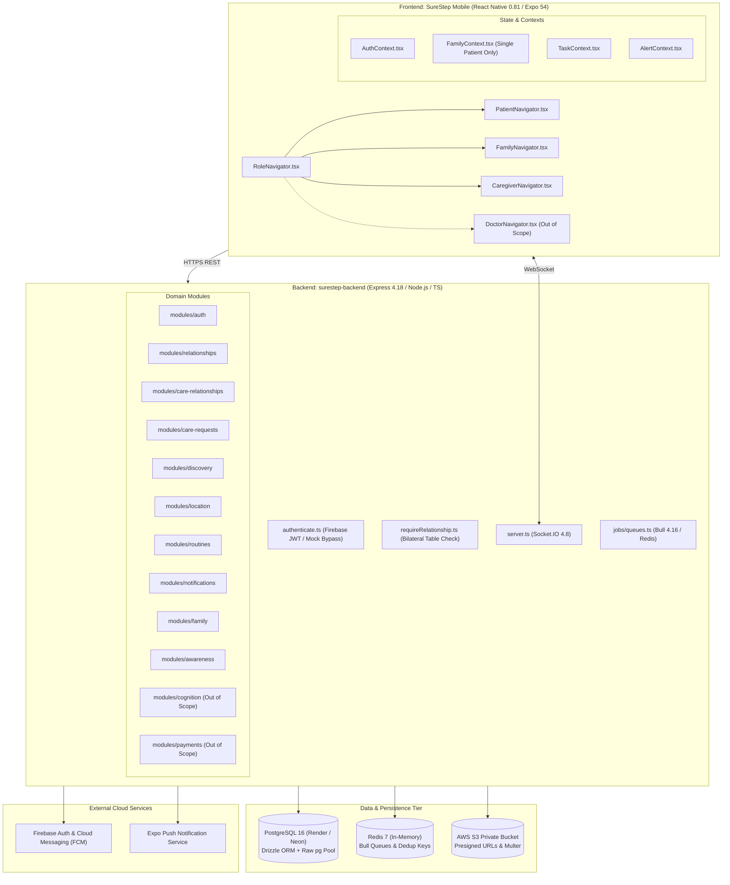
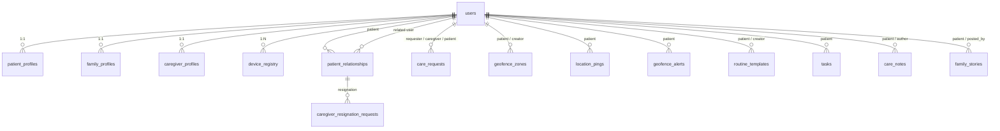
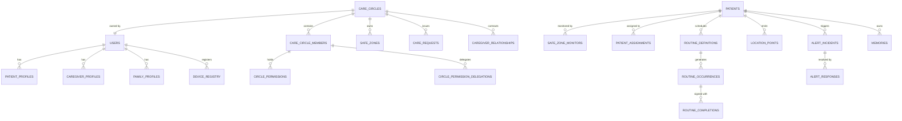
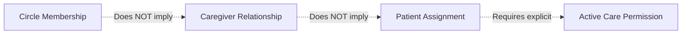
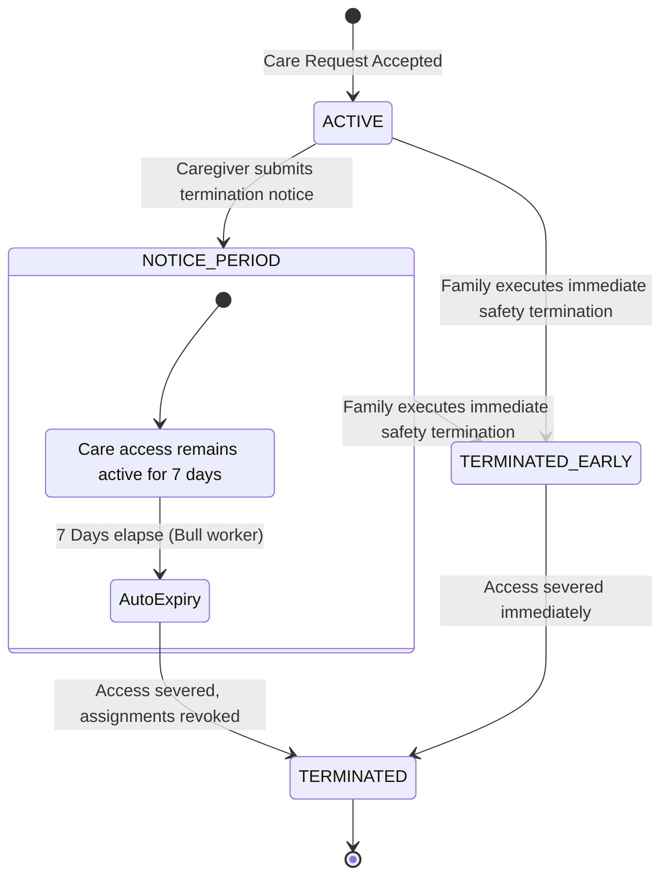
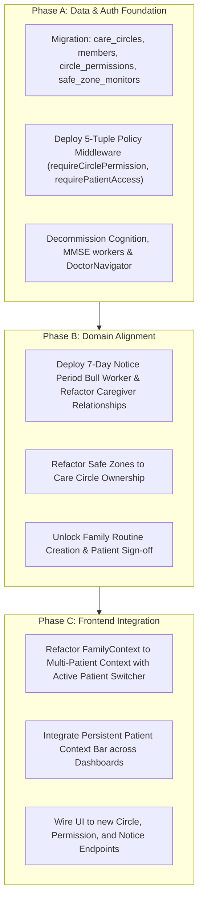
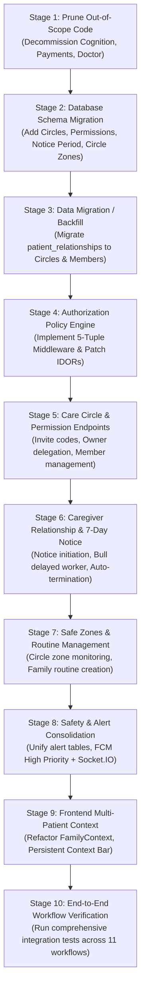

# SureStep V1 — Architecture & Codebase Implementation Audit

**Document:** `docs/audits/ARCHITECTURE_AUDIT.md`  
**Date:** October 27, 2026  
**Auditor:** Principal System Architect & Codebase Auditor  
**Audit Type:** Read-Only Technical Architecture & Implementation Assessment  
**Baseline Requirements:** `docs/requirements/V1_REQUIREMENT.md`  
**Baseline Workflows:** `docs/workflows/01-IDENTITY.md` through `11-ACCOUNT-AND-SETTINGS.md`  
**Audited Repositories:** `SureStep/` (Mobile Client) & `surestep-backend/` (API Server & Workers)

---

## 1. Executive Summary

This architecture audit evaluates the existing SureStep repository against the ratified V1 Requirements and the 11 finalized Core Workflows. The primary goal is to determine how the existing codebase can safely, correctly, and reliably implement the product behavior defined in the baseline specifications without necessitating an unnecessary ground-up rewrite.

### Key Audit Findings:
1. **Solid Runtime Foundations:** The existing technical stack—**Expo SDK 54 / React Native 0.81** on the frontend, and **Node.js / Express 4.18 / TypeScript / Drizzle ORM / PostgreSQL 16** on the backend, complemented by **Socket.IO 4.8**, **Bull 4.16 / Redis**, and **Firebase Phone Auth / FCM**—is modern, mature, and structurally reusable.
2. **Critical Architectural Mismatches (P0):**
   - **Absence of Care Circle Domain:** The backend database contains no `care_circles` or `care_circle_members` entities. Relationships are modeled as a flat, bilateral table (`patient_relationships`) with inverted ownership where Caregivers generate invite codes and approve Family members.
   - **Authorization Inversion & IDOR Vulnerabilities:** `familyPermissions.ts` explicitly marks family members as forbidden from editing geofences, routines, or acknowledging alerts. Furthermore, endpoints such as `PATCH /api/v1/geofences/:id`, `DELETE /api/v1/geofences/:id`, `PATCH /api/v1/tasks/:id`, and `DELETE /api/v1/tasks/:id` lack ownership checks, allowing any authenticated user to mutate or deactivate resources across patient boundaries.
   - **Missing 7-Day Caregiver Notice Period:** The backend implements an interactive resignation request in `caregiver_resignation_requests` (`017_caregiver_resignation_requests.sql`) that family members can decline, directly contradicting the approved non-interactive 7-day `Notice Period` transition.
   - **Single-Patient Assumption in Frontend:** `FamilyContext.tsx` and `family.router.ts` (`LIMIT 1`) assume a family member has exactly one patient. There is no active Patient Context switcher or stale-context eviction, violating the Wrong-Patient Prevention Framework.
3. **Explicit V1 Scope Contradictions (Must be Decommissioned):**
   - The codebase contains clinical cognitive scoring, MMSE tests, and dementia prediction modules (`modules/cognition/`, `modules/assessment/`, `50_cognition.sql`, `DoctorNavigator.tsx`, and `weeklyReportQueue`). These violate V1 Requirement §2.4 & §12 and must be removed from the V1 runtime.
   - Payment gateways (`modules/payments/`, `80_payments.sql`) are present but excluded from V1.

**Readiness Conclusion:** **`READY AFTER ARCHITECTURAL CHANGES`**. The product requirements are fully resolved, but the architectural foundations (Care Circle tenancy, 5-tier decoupled authorization, notice period state machine, and multi-patient context) must be established before workflow feature completion can proceed safely.

---

## 2. Current-State Architecture Map



### 2.1 Frontend Architecture (`SureStep/`)
- **Framework & Runtime:** Expo SDK `~54.0.34`, React Native `0.81.5`, React `19.1.0`.
- **Navigation:** `@react-navigation/native` v7 with `@react-navigation/native-stack` and `@react-navigation/bottom-tabs`. Managed via `RoleNavigator.tsx`, which dispatches to role-scoped stacks (`PatientNavigator.tsx`, `FamilyNavigator.tsx`, `CaregiverNavigator.tsx`, and `DoctorNavigator.tsx`).
- **Styling:** NativeWind `4.2.7` / TailwindCSS `3.4.17` with custom design tokens in `src/theme/colors.ts` and `src/theme/fonts.ts`.
- **State Management:** React Context API with 13 specialized providers (`AuthContext`, `FamilyContext`, `CaregiverContext`, `TaskContext`, `AlertContext`, `PatientStateContext`, `ReminderContext`, `GeofenceContext`, etc.). No Redux or Zustand.
- **API & Networking:** Axios instance in `src/services/apiClient.ts` configured with request interceptors attaching Firebase Bearer tokens. Socket client in `src/services/socketClient.ts` connecting to backend Socket.IO.
- **Authentication:** `@react-native-firebase/auth` v24 with Phone Auth (SMS OTP). Development bypass tokens (`mock-dev-patient-token`, etc.) handled in `AuthContext.tsx`.
- **Location & Sensors:** `react-native-background-geolocation` v5.1.1 and `expo-location` v19.0.8 wrapped in `src/services/backgroundLocationService.ts`.
- **Audio & Haptics:** `expo-av` v16.0.8 and `src/services/localAlarmService.ts` for local high-priority audio reminders.

### 2.2 Backend Architecture (`surestep-backend/`)
- **Framework & Runtime:** Node.js v20+, Express `4.18.2`, TypeScript `5.3.3`.
- **Architecture Pattern:** Layered modular monolith organized under `modules/` with express routers, controllers, and services.
- **Database Access:** Hybrid architecture utilizing Drizzle ORM (`drizzle-orm` `0.45.4`) for schema definition (`db/schema/index.ts`) and direct connection pool queries via `pg` (`8.21.0`) in `db/config.ts`.
- **Authentication Middleware:** `shared/middleware/authenticate.ts` verifies Firebase JWTs via `firebase-admin` v13.10, resolves the user in PostgreSQL, and attaches `req.user`. Includes auto-provisioning for `mock-dev-*` tokens.
- **Authorization Middleware:** `requireRoles()` checks user role; `requireRelationship()` queries `patient_relationships` table.
- **Real-Time Communication:** `socket.io` `4.8.3` initialized in `server.ts` with JWT authentication handshake, joining `user:{id}` and `patient:{id}` rooms.
- **Background Jobs:** `bull` `4.16.5` backed by `ioredis` `5.10.1` defined in `jobs/queues.ts`. Manages routine sweeps, no-signal checks, reminder escalations, and care request expirations.
- **Media & File Handling:** `@aws-sdk/client-s3` v3.1048.0 with pre-signed URL helpers and `multer` for multipart form uploads.

### 2.3 Database Schema & Migrations
- **Database Engine:** PostgreSQL 16 with UUID generation (`gen_random_uuid()`).
- **Migration Pipeline:** 17 ordered SQL files in `db/migrations/` managed by custom runner `db/migrator.ts`, recording applied scripts in `_migrations` table.
- **Existing Tables:**
  - Identity & Profiles: `users`, `patient_profiles`, `family_profiles`, `caregiver_profiles`, `device_registry`.
  - Relationships: `patient_relationships`, `caregiver_resignation_requests`, `invite_codes`.
  - Care & Discovery: `care_requests`, `routine_templates`, `tasks`, `task_attachments`, `care_notes`.
  - Location & Safety: `location_pings`, `geofence_zones`, `geofence_alerts`, `patient_states`, `patient_state_history`, `alerts`.
  - Engagement & Voice: `familiarity_assets`, `family_stories`, `voice_messages`, `message_threads`, `messages`.
  - Prohibited / Out-of-Scope Tables: `cognitive_assessments`, `mmse_scores`, `game_metrics`, `payments`, `subscriptions`.

### 2.4 External Services
1. **Firebase Authentication:** Phone Number SMS OTP verification.
2. **Firebase Cloud Messaging (FCM):** Push notifications via `firebase-admin`.
3. **Expo Push Notification Service:** Fallback push service for Expo Go/client tokens.
4. **AWS S3:** Storage of patient voice notes, family photos, story thumbnails, and caregiver documents.
5. **OpenStreetMap / Mapbox:** Geocoding and reverse geocoding in location utilities.

---

## 3. Workflow-to-Code Mapping

Every V1 workflow is mapped below through the concrete frontend screens, API endpoints, backend services, database tables, and external services.

| Workflow | Frontend Screen / Component | API Route | Backend Service / Module | Database Table | External Service | Implementation Status | Concrete Code Finding & Evidence |
| :--- | :--- | :--- | :--- | :--- | :--- | :---: | :--- |
| **01 Identity** | `PhoneInputScreen.tsx`, `OtpScreen.tsx`, `RoleSelectScreen.tsx` | `POST /api/v1/auth/session`, `POST /api/v1/auth/provision` | `modules/auth/auth.service.ts` | `users`, `device_registry` | Firebase Phone Auth | **Partially Implemented** | SMS OTP and user provisioning work. Lacks account deactivation and multi-role persona switching within the same phone session. |
| **02 Patient Onboarding** | `PatientOnboardingScreen.tsx`, `PatientHomeScreen.tsx` | `POST /api/v1/users/patient/profile` | `modules/users/users.service.ts` | `patient_profiles` | S3 (photo) | **Partially Implemented** | Basic profile fields exist in `012_patient_onboarding_fields.sql`. Missing direct Care Circle attachment during onboarding. |
| **03 Care Circle** | `FamilyLinkPatientScreen.tsx`, `CaregiverCareCircleScreen.tsx` | `POST /relationships/invite-code/generate`, `GET /family/care-circle` | `modules/relationships/relationships.service.ts`, `modules/family/family.router.ts` | `patient_relationships`, `invite_codes`, `care_notes` | None | **Implemented Incorrectly Relative to Workflow** | **P0 Contradiction:** No `care_circles` table exists. Caregiver generates invite code for family (`relationships.router.ts:39`); caregiver approves family (`relationships.router.ts:75`). Granular delegatable permissions (`Manage Member Permissions`, etc.) are completely missing. |
| **04 Patient Care** | `CaregiverRoutineEditorScreen.tsx`, `PatientHomeScreen.tsx` | `GET /tasks/patient/:id/today`, `POST /tasks/:id/status`, `POST /routines/patient/:id` | `modules/routines/routines.service.ts`, `jobs/queues.ts` | `routine_templates`, `tasks`, `task_attachments` | Local Alarm (`expo-av`) | **Implemented Incorrectly Relative to Workflow** | **Inverted Authority:** Only caregivers can create/edit routine templates (`routines.router.ts:23, 30`). Family members are forbidden from managing routines. Missing Wrong-Patient assignment validation on sign-off. |
| **05 Caregiver Discovery** | `CareDiscoveryScreen.tsx`, `CaregiverProfileScreen.tsx`, `CareRequestScreen.tsx` | `GET /care/discovery/caregivers`, `POST /care-requests` | `modules/discovery/discovery.service.ts`, `modules/care-requests/care-requests.service.ts` | `caregiver_profiles`, `care_requests` | OSM Geocoding | **Partially Implemented** | Radius query and city normalizer work well (`cityNormalizer.ts`). Missing enforcement of 7 mandatory fields before discoverability and platform misconduct reporting endpoint. |
| **06 Caregiver Relationship** | `CareRequestsListScreen.tsx`, `CareRequestDetailScreen.tsx` | `POST /care-relationships/:id/end`, `POST /care-relationships/:id/resignation` | `modules/care-relationships/care-relationships.service.ts` | `caregiver_resignation_requests`, `patient_relationships` | FCM Push | **Implemented Incorrectly Relative to Workflow** | **P0 Contradiction:** Implements interactive resignation request that Family can decline (`care-relationships.router.ts:36`, `017_caregiver_resignation_requests.sql`). Contradicts approved 7-day automatic non-interactive `Notice Period`. |
| **07 Safety** | `FamilyAlertsScreen.tsx`, `CaregiverAlertFeedScreen.tsx` | `POST /alerts/sos`, `POST /alerts/acknowledge`, `POST /alerts/resolve` | `modules/notifications/notifications.router.ts`, `modules/awareness/awareness.service.ts` | `geofence_alerts`, `alerts` | FCM (High Priority), Socket.IO | **Partially Implemented** | Realtime alert broadcast and FCM push work (`fcm.service.ts:145`). Uses `geofence_alerts` for all alert types. Lacks multi-tier alert escalation timer and deduplication window tuning. |
| **08 Location & Safe Zones** | `FamilyMapScreen.tsx`, `CaregiverGeofenceEditorScreen.tsx` | `POST /location/ping`, `POST /geofences/patient/:id`, `PATCH /geofences/:id` | `modules/location/location.service.ts`, `modules/awareness/awareness.service.ts` | `location_pings`, `geofence_zones`, `patient_states` | PostGIS / OSM | **Implemented Incorrectly Relative to Workflow** | **P0 Invariant Violation & Security Risk:** Safe zones are tied directly to `patient_id` rather than Care Circle (`30_location_geofencing.sql:29`). `PATCH /geofences/:id` and `DELETE /geofences/:id` have NO authorization checks (IDOR vulnerability). |
| **09 Memories & Activities** | `FamilyStoriesScreen.tsx`, `PatientStoriesScreen.tsx`, `PatientGamesScreen.tsx` | `GET /familiarity/stories`, `POST /media/upload` | `modules/voice/voice.service.ts`, `modules/media/media.router.ts` | `family_stories`, `familiarity_assets` | AWS S3 | **Partially Implemented** | Media upload and story feed work. Missing default `ALL_CONNECTED` audience scoping column and `Manage Patient Memories` permission guard. Games in `src/games/` are good, but backend MMSE cognitive scoring must be purged. |
| **10 Notifications & Activity** | `NotificationHistoryScreen.tsx`, `NotificationSettingsScreen.tsx` | `GET /alerts/history`, `POST /notifications/preferences` | `modules/notifications/notification.service.ts`, `fcm.service.ts` | `notification_logs`, `patient_state_history` | FCM, Expo Push | **Partially Implemented** | Preference routing works (`fcm.service.ts:180`). Missing immutable append-only `audit_logs` ledger for permission changes, boundary edits, and relationship terminations. |
| **11 Account & Settings** | `FamilySettingsScreen.tsx`, `CaregiverSettingsScreen.tsx` | `GET /users/me`, `PATCH /users/me` | `modules/users/users.service.ts` | `users`, `family_profiles`, `caregiver_profiles` | Firebase Admin | **Missing** | Account deletion request with 14-day cooling-off period, session token revocation (`adminAuth.revokeRefreshTokens`), and personal data export are completely missing. |

---

## 4. Current Domain Model

The existing domain model in PostgreSQL is organized around 18 active tables, but suffers from architectural gaps:



### Critical Deficiencies in Current Model:
1. **No Care Circle Concept:** All member access is stored in `patient_relationships(patient_user_id, related_user_id, relationship_type, status)`. There is no group entity (`care_circles`), meaning multiple family members caring for the same patient have no shared administrative container.
2. **Missing Granular Permissions:** `patient_relationships` only has a coarse `relationship_type` enum (`FAMILY_PRIMARY`, `FAMILY_SECONDARY`, `FAMILY_CLOSE`, `CAREGIVER`, `GUARDIAN`). Delegatable permissions (`Manage Member Permissions`, `Manage Caregiver Relationships`, `Search/Request Caregivers`, `Manage Patient Memories`, `Manage Safe Zones`, `Manage Routines`) do not exist.
3. **Safe Zones Tied to Patient:** `geofence_zones` has `patient_id UUID NOT NULL REFERENCES users(id)`. Safe zones cannot be shared across multiple patients in the same household or day center.
4. **Caregiver Resignation vs 7-Day Notice:** `caregiver_resignation_requests` contains interactive status (`PENDING`, `ACCEPTED`, `DECLINED`), allowing family to decline a caregiver's exit.
5. **No Audit Ledger:** No `audit_logs` table exists to capture safety-critical mutations.

---

## 5. Required Domain Model

To fully operationalize the 11 workflows and V1 Requirements, the domain model must be incrementally evolved into **21 clean entities** with clear tenant and authorization boundaries.



### Entity Specifications & Boundaries:
1. **`care_circles`:** Top-level tenancy boundary.
   - *Fields:* `id`, `name`, `owner_id` (FK to `users`, RESTRICT), `created_at`, `updated_at`, `deleted_at`.
   - *Ownership:* Owned exclusively by the primary Family Member (`owner_id`).
2. **`care_circle_members`:** Membership bridge table.
   - *Fields:* `id`, `circle_id` (CASCADE), `user_id` (CASCADE), `role_in_circle` (`OWNER`, `MEMBER`, `CAREGIVER`), `joined_at`.
   - *Unique:* `(circle_id, user_id)`.
3. **`circle_permissions`:** Granular delegatable permissions.
   - *Fields:* `id`, `member_id` (FK to `care_circle_members`, CASCADE), `permission_name` (`Manage Member Permissions`, `Manage Caregiver Relationships`, `Search/Request Caregivers`, `Manage Patient Memories`, `Manage Safe Zones`, `Manage Routines`), `granted_by`, `granted_at`.
   - *Unique:* `(member_id, permission_name)`.
4. **`caregiver_relationships`:** Caregiver contract and 7-day notice state machine.
   - *Fields:* `id`, `circle_id`, `caregiver_id`, `status` (`ACTIVE`, `NOTICE_PERIOD`, `TERMINATED`, `TERMINATED_EARLY`), `notice_started_at`, `notice_expires_at`, `ended_at`, `termination_reason`, `termination_notes`.
5. **`patient_assignments`:** Decoupled caregiver-to-patient care scope.
   - *Fields:* `id`, `relationship_id` (CASCADE), `patient_id` (CASCADE), `assigned_by`, `is_active`, `assigned_at`.
   - *Rule:* Caregiver access to telemetry/routines requires an active row here.
6. **`safe_zones` & `safe_zone_monitors`:** Circle-owned geofences.
   - `safe_zones`: `id`, `circle_id` (CASCADE), `name`, `zone_type` (`CIRCLE`, `POLYGON`), `center_lat`, `center_lng`, `radius_meters`, `polygon_coords` (JSONB).
   - `safe_zone_monitors`: `id`, `safe_zone_id` (CASCADE), `patient_id` (CASCADE), `alert_on_exit`, `alert_on_entry`.
7. **`audit_logs`:** Append-only tamper-evident ledger.
   - *Fields:* `id`, `actor_id`, `circle_id`, `patient_id`, `action`, `entity_type`, `entity_id`, `previous_state` (JSONB), `new_state` (JSONB), `created_at`. No `UPDATE` or `DELETE` grants.

---

## 6. Authorization Architecture

Authorization is the single most critical architectural boundary in SureStep V1.

### 6.1 The 5-Tuple Policy Evaluation Model
Every request is evaluated through:
$$\text{Decision} = \mathcal{P}(\text{Actor}, \text{Operation}, \text{Target}, \text{Context}, \text{ActivePermissions})$$

### 6.2 Decoupled Authority Invariant
The architecture enforces five independent authority tiers:
1. **Authentication:** Validates identity only (`userId`). Does not confer access to any patient or circle.
2. **Circle Membership:** Grants participation in a Care Circle (`circleId`). Does **not** grant routine editing, safe zone deletion, or caregiver hiring.
3. **Delegated Permissions:** Explicit capabilities assigned to a member (`Manage Caregiver Relationships`, `Manage Patient Memories`, etc.).
4. **Caregiver Relationship State:** Must be `ACTIVE` or `NOTICE_PERIOD`.
5. **Patient Assignment:** Must explicitly link the Caregiver to the specific `patientId`.



### 6.3 Server-Side Guard Implementation
Frontend UI element hiding is strictly cosmetic. All security boundaries are enforced server-side:

```typescript
// Proposed Server-Side Authorization Pipeline
router.post(
  '/care-circles/:circleId/safe-zones',
  authenticate,
  requireCircleAccess,
  requireCirclePermission('Manage Safe Zones'),
  createSafeZoneHandler,
);

router.get(
  '/patients/:patientId/location/trail',
  authenticate,
  requirePatientAccess('READ_LOCATION'),
  getLocationTrailHandler,
);
```

### 6.4 Identification of Existing Authorization Vulnerabilities (IDOR)
In the current codebase:
1. `PATCH /api/v1/geofences/:id` and `DELETE /api/v1/geofences/:id` in `location.router.ts:37-38` have no ownership check. In `location.controller.ts:212`, `deactivateZone(req.params.id)` accepts any ID without verifying if the caller belongs to the patient's care circle.
2. `PATCH /api/v1/tasks/:id` and `DELETE /api/v1/tasks/:id` in `routines.router.ts:74-75` check only `requireRoles('CAREGIVER')`, allowing any caregiver in the database to mutate tasks belonging to any patient.
3. **Remediation:** Middleware must resolve the resource's `circle_id` / `patient_id` and evaluate caller permissions before executing controller logic.

---

## 7. State Machines

### 7.1 Caregiver Relationship & Notice Period State Machine (Approved P1 Decision)



- **Authoritative State:** `caregiver_relationships.status`.
- **Transitions & Actors:**
  - `ACTIVE` $\to$ `NOTICE_PERIOD`: Caregiver only. Non-interactive; Family cannot decline.
  - `ACTIVE` / `NOTICE_PERIOD` $\to$ `TERMINATED_EARLY`: Family Member holding `Manage Caregiver Relationships`.
  - `NOTICE_PERIOD` $\to$ `TERMINATED`: System background worker after exactly 7 days ($7 \times 24\text{ hours}$).
- **Where Current Code Fails:** `modules/care-relationships/care-relationships.service.ts:49` explicitly blocks caregivers from ending relationships, forcing them into a `resignation_request` that family can decline.

### 7.2 Care Request State Machine
- **States:** `PENDING`, `ACCEPTED`, `DECLINED`, `WITHDRAWN`, `EXPIRED`.
- **Authoritative State:** `care_requests.status`.
- **Expiry:** Bull queue sweeps requests where `NOW() > expires_at` (72 hours).
- **Current Status:** Well implemented in `modules/care-requests/care-requests.service.ts`.

### 7.3 Routine Occurrence State Machine
- **States:** `PENDING`, `COMPLETED`, `SNOOZED`, `MISSED`, `MISSED_CRITICAL`.
- **Authoritative State:** `tasks.status`.
- **Transitions:**
  - Overdue by $> 15\text{ min}$: Evaluated to `BEHIND`.
  - Overdue by $> 60\text{ min}$: Transitioned to `MISSED` by `routineSweepQueue`. If `is_critical = true`, transitions to `MISSED_CRITICAL` and raises an emergency alert.
  - Sign-off: Transitioned to `COMPLETED` with sign-off actor recorded.
- **Where Current Code Fails:** Family cannot define routines; routine editor is locked to caregivers.

### 7.4 Safety Alert Incident State Machine
- **States:** `ACTIVE`, `ACKNOWLEDGED`, `RESOLVED`, `FALSE_ALARM`.
- **Authoritative State:** `alerts.status`.
- **Transitions:** Any active Care Circle member or assigned caregiver can `ACKNOWLEDGE` (claiming response) or `RESOLVE` (dismissing banner).
- **Where Current Code Fails:** Duplicate alert tables (`geofence_alerts` vs `alerts`) create confusion; `notifications.router.ts:284` queries `geofence_alerts` while `alerts.router.ts` queries `alerts`.

### 7.5 Account Deletion Lifecycle
- **States:** `ACTIVE`, `DELETION_REQUESTED`, `COOLING_OFF` (14 Days), `ANONYMIZED_PURGED`.
- **Authoritative State:** `account_deletion_requests.status` and `users.is_active`.
- **Where Current Code Fails:** Completely missing from codebase.

---

## 8. Data Ownership and Privacy

### 8.1 Care Circle Tenancy & Data Scoping
| Data Domain | Storage Entity | Owner / Custodian | Post-Caregiver Termination | Post-Circle Deletion |
| :--- | :--- | :--- | :--- | :--- |
| **Patient Profile & Health** | `patient_profiles` | Care Circle Owner | Caregiver access severed immediately | Retained by Patient / Anonymized |
| **Routines & Adherence** | `routine_definitions`, `routine_occurrences` | Care Circle Owner | Caregiver access severed immediately | Soft-deleted with Circle |
| **Location Telemetry** | `location_points` | Care Circle / Patient | Caregiver access severed immediately | Purged after 90 days retention |
| **Safe Zones** | `safe_zones`, `safe_zone_monitors` | Care Circle Owner | Caregiver cannot view or edit | Soft-deleted with Circle |
| **Safety Alerts** | `alert_incidents`, `alert_responses` | Care Circle | Historical view revoked | Anonymized for liability audit |
| **Memories & Stories** | `memories`, `family_stories` | Patient / Care Circle | Caregiver access severed | Exportable by Family |
| **Audit Logs** | `audit_logs` | System Ledger | Immutable | Retained in cold archive |

### 8.2 Non-Diagnostic Telemetry Boundary (Requirement §2.4 & §12)
The architecture strictly enforces:
$$\text{Raw Telemetry Only} \quad \centernot\implies \quad \text{Clinical Staging or Dementia Scoring}$$
- **Prohibited Modules in Codebase:**
  - `modules/cognition/` (`cognition.service.ts`, `reports.router.ts`)
  - `modules/assessment/` (`assessment.service.ts`)
  - `db/schema/50_cognition.sql` (`cognitive_assessments`, `mmse_scores`, `game_metrics`)
  - Bull queue `weeklyReportQueue` (`jobs/queues.ts:163-223`) computing memory/attention scores.
- **Decommissioning Action:** Purge cognitive scoring routers and workers from the V1 runtime. Store only raw game duration and interaction timestamps in engagement logs.

---

## 9. API & Service Architecture

The backend architecture must be organized into 10 cohesive, single-responsibility domain modules under `modules/`:

```
surestep-backend/src/modules/
├── auth/                 # Identity, Firebase token exchange, sessions
├── circle/               # Care Circle tenancy, invitations, delegations
├── patient-care/         # Patient profiles, routines, medication occurrences
├── discovery/            # Caregiver directory, geo search, misconduct reporting
├── care-relationships/   # Care requests, 7-day notice period, assignments
├── location/             # Raw telemetry ingestion, location trail
├── safe-zones/           # Circle safe zones, multi-patient monitoring
├── safety/               # Alert incident lifecycle, SOS, FCM dispatch
├── memories/             # Patient memory cards, S3 presigned uploads
└── audit/                # Immutable system ledger
```

### Service Responsibility & Auth Table:
| Service Module | Primary Entities | Required Authority Guard | Key Operations |
| :--- | :--- | :--- | :--- |
| **`modules/circle`** | `care_circles`, `care_circle_members`, `circle_permissions` | Circle Owner OR `Manage Member Permissions` | Create circle, invite members, delegate/revoke permissions. |
| **`modules/care-relationships`** | `care_requests`, `caregiver_relationships`, `patient_assignments` | `Manage Caregiver Relationships` / Assigned Caregiver | Send request, respond, submit 7-day notice, immediate termination. |
| **`modules/safe-zones`** | `safe_zones`, `safe_zone_monitors` | `Manage Safe Zones` | Create circle zone, attach patients, set exit/entry rules. |
| **`modules/patient-care`** | `routine_definitions`, `routine_occurrences`, `routine_completions` | `Manage Routines` (Family) / Assigned Caregiver (Sign-off) | Define medication schedules, generate occurrences, sign off completion. |
| **`modules/memories`** | `memories`, `family_stories` | `Manage Patient Memories` (Write) / Connected (Read) | Upload photo/voice card, view memory lane (`ALL_CONNECTED`). |
| **`modules/safety`** | `alert_incidents`, `alert_responses` | Care Circle Member / Assigned Caregiver | Dispatch SOS, acknowledge alert, mark resolved. |

### APIs Mixing Unrelated Responsibilities (To Be Refactored):
- `relationships.router.ts`: Combines caregiver discovery, invite code redemption, family request approvals, and relationship terminations. Must be split into `modules/circle`, `modules/discovery`, and `modules/care-relationships`.
- `location.router.ts`: Mixes raw GPS telemetry ingestion with geofence CRUD and alert acknowledgments. Geofences must move to `modules/safe-zones`.

---

## 10. Frontend Architecture

### 10.1 Persona Navigation Trees
The frontend strictly isolates experiences using three dedicated navigators mounted via `RoleNavigator.tsx`:
1. **Patient Experience (`PatientNavigator.tsx`):**
   - High-contrast, large touch targets, minimal cognitive friction.
   - Core tabs: Today's Routine Agenda (`HomeTab`), Family Memory Lane (`FamilyTab`), Mini-Activities (`ActivitiesTab`), Care Team Contacts (`CareTeamTab`).
   - Background location pings; non-dismissible emergency SOS button.
2. **Family Experience (`FamilyNavigator.tsx`):**
   - Comprehensive care coordination dashboard.
   - Care Circle management, delegatable permission toggles, Circle Safe Zone map editor, caregiver search, and routine scheduling.
3. **Caregiver Experience (`CaregiverNavigator.tsx`):**
   - Daily operational shift agenda across assigned patients.
   - Quick routine checklist sign-offs, emergency triage banner, and 7-day notice initiation modal.

### 10.2 Wrong-Patient Prevention Framework
In multi-patient care (e.g. adult child managing both mother and father):
1. **Persistent Visual Context Bar:** A fixed, non-dismissible banner at the top of the mobile screen displaying:
   - Patient Photo & Legal/Preferred Name
   - Emergency Contact Quick-Dial
   - Primary Caregiver Badge
2. **Context Switching Guard:**
   - `FamilyContext.tsx` must be refactored from `patient: FamilyPatient | null` to:
     ```typescript
     interface MultiPatientFamilyContext {
       patients: FamilyPatient[];
       activePatientId: string | null;
       setActivePatientId: (id: string) => void;
     }
     ```
   - Switching `activePatientId` **must clear** all in-memory caches, draft notes, and active WebSocket rooms (`leave:patient`, `join:patient`), preventing stale patient data bleed.

---

## 11. Critical Architectural Risks

### Priority 0 (P0) — Blocking / Unsafe
1. **Missing Care Circle & Delegation Entities:** Inverted authority where caregivers approve family and lack of `care_circles` table makes V1 workflow execution impossible.
2. **Insecure Direct Object Reference (IDOR) on Geofences and Tasks:** `PATCH/DELETE /geofences/:id` and `PATCH/DELETE /tasks/:id` permit unauthorized cross-patient tampering.
3. **Resignation Rejection Logic:** Existing code allows family to reject a caregiver's resignation, violating the approved non-interactive 7-day notice period.
4. **Single-Patient Assumption in Frontend:** `FamilyContext.tsx` has no patient selector, causing silent data corruption in multi-patient circles.

### Priority 1 (P1) — Major Structural Issues
1. **Routine Management Inversion:** Family members cannot create or configure routines in the current API (`requireRoles('CAREGIVER')`).
2. **Safe Zones Bound to Individual Patient:** Geofences tied to `patient_id` prevent multi-patient household monitoring.
3. **Dual Alert Tables:** Simultaneous presence of `geofence_alerts` and `alerts` causes split-brain alert tracking.
4. **Prohibited MMSE / Cognitive Modules:** Active cognitive scoring queues violate V1 Requirements §2.4 & §12 and risk regulatory non-compliance.

### Priority 2 (P2) — Technical Debt & Robustness
1. **Lack of Automated Unit / Integration Test Runner:** No Jest/Mocha setup in `surestep-backend/package.json` (only manual scripts in `scripts/`).
2. **Missing Immutable Audit Ledger:** No `audit_logs` table for statutory tracking of safety boundary and permission changes.
3. **Unbounded Telemetry Growth:** `location_pings` table lacks table partitioning for long-term scalability.

---

## 12. Recommended Target Architecture

Rather than an expensive, destabilizing ground-up rewrite, the recommended path is an **Incremental Evolution of the Modular Monolith**:



### Architectural Change Matrix:
| Component | Current Problem | Proposed Evolutionary Change | Workflows Affected | Migration Impact |
| :--- | :--- | :--- | :--- | :---: |
| **Care Circle Tenancy** | Flat `patient_relationships` with inverted caregiver control. | Introduce `care_circles`, `care_circle_members`, and `circle_permissions`. Backfill existing links into default circles. | 03, 05, 06, 08 | High (Schema migration + backfill script) |
| **Authorization Engine** | Hardcoded role guards (`requireRoles('CAREGIVER')`) and IDOR bugs. | Replace with resource-aware middleware checking Circle Owner status or explicit delegated permissions. | 03, 04, 06, 08, 09 | Medium (Middleware refactor) |
| **Caregiver Notice Period** | Resignation request can be declined by family. | Implement `NOTICE_PERIOD` status with 7-day Bull delayed transition worker. Remove resignation request table. | 06 | Medium (Remove migration 017 tables, add notice fields) |
| **Safe Zone Tenancy** | Geofences owned by individual patient. | Add `circle_id` to `geofence_zones`, add `safe_zone_monitors` junction table. | 07, 08 | Medium (Schema migration) |
| **Frontend Patient Context** | `FamilyContext` assumes 1 patient; no switcher. | Multi-patient array in `FamilyContext` with explicit `activePatientId` and cache flush on switch. | 02, 03, 04, 07, 08 | Medium (React context update) |
| **Prohibited Cognition** | MMSE scoring, doctor navigator, and payments present in runtime. | Unmount routers in `server.ts`, disable `weeklyReportQueue`, remove `DoctorNavigator.tsx`. | 09, 11 | Low (Route unmounting) |

---

## 13. Implementation Sequence

The architectural implementation must follow a strict, dependency-aware 10-stage sequence:



### Stage Justification & Dependencies:
- **Stages 1–3 must precede Stage 4:** The authorization engine cannot enforce Care Circle or delegated permissions until the underlying schema entities exist.
- **Stage 4 must precede Stages 5–8:** No domain endpoints should be exposed without the new resource-aware authorization guards in place.
- **Stage 8 precedes Stage 9:** Frontend UI requires stable, consolidated alert and routine endpoints before multi-patient switching can be verified.

---

## 14. Decisions Requiring Product Input

All core product requirements and workflow behaviors were settled in the approved consistency audit. However, two minor product-boundary confirmations should be verified with the Product Owner:

### Decision 1: Offline Telemetry Age Threshold for Alert Evaluation
- **Context:** When a patient device reconnects after being offline, it batch-syncs location pings (`POST /api/v1/location/pings/sync`).
- **Product Question:** If an offline ping indicates a safe zone breach that occurred 3 hours ago, should the system trigger a retrospective Critical Alert, or record it in the historical trail only?
- **Recommended Option:** Record in the historical trail and post an informational note, but do **not** trigger real-time sirens/push notifications for historical breaches $> 30\text{ minutes}$ old to prevent alarming responders unnecessarily.

### Decision 2: Emergency Contact Cascade Order
- **Context:** When an SOS is triggered, FCM broadcasts to the entire Care Circle.
- **Product Question:** Does the primary Family Owner receive an automated phone call (via Twilio/telephony), or is V1 strictly push notification and in-app siren?
- **Recommended Option:** V1 baseline specifies high-priority FCM push + WebSocket in-app siren. Telephony voice calls remain in Deferred (§12).

---

## 15. Architecture Readiness Assessment

### Conclusion:
# **READY AFTER ARCHITECTURAL CHANGES**

### Architectural Blockers Requiring Resolution Before Implementation:
1. **Care Circle Entity & Tenancy Deployment:** Database must be migrated to include `care_circles`, `care_circle_members`, `circle_permissions`, and `circle_permission_delegations`. Existing `patient_relationships` must be migrated into this structure.
2. **Server-Side Authorization & IDOR Remediation:** The 5-tuple authorization middleware must be deployed, replacing hardcoded role checks and securing unprotected `PATCH/DELETE` endpoints.
3. **Caregiver 7-Day Notice Period State Machine:** Replace the resignation request approval flow with the non-interactive 7-day `NOTICE_PERIOD` state machine and Bull delayed worker.
4. **Multi-Patient Context & Context Bar in Frontend:** Refactor `FamilyContext.tsx` to support multiple patients with explicit active patient selection and state eviction on switch.
5. **Decommission Prohibited V1 Modules:** Remove cognitive scoring (`modules/cognition`, `modules/assessment`), doctor persona (`DoctorNavigator.tsx`), and payment processing from the active build.

Once these architectural foundations are deployed, the existing codebase will be fully capable of reliably and safely supporting all 11 SureStep V1 Workflows.

