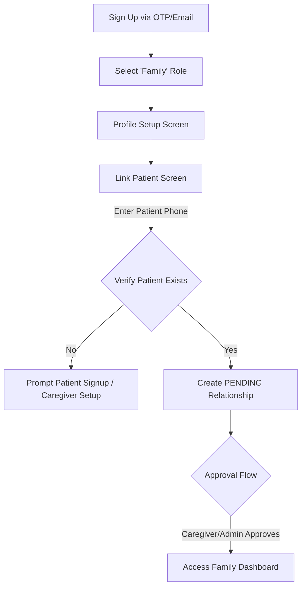

# SureStep — Family Role Specification & Screen Architecture

This document provides a comprehensive analysis of the **FAMILY** role within the SureStep platform. It defines the end-to-end journey from registration and patient-linking to dashboard layouts, real-time tracking, alert systems, memory-sharing features, and permission control boundaries.

---

## 1. Onboarding & Registration Journey

The family member's onboarding journey focuses on warmth, simple configuration, and establishing secure links to the patient.

### Screen 1: Authentication & Role Selection
*   **Authentication**: OTP validation via Firebase phone auth or standard email signup.
*   **Role Option Card**: Select **"Family Member / Guardian"** (calming, soft teal-themed illustration of a family holding hands).

### Screen 2: Basic Info & Relationship Setup
*   **Circular Avatar Upload**: Capture the family member's photo so it displays on the caregiver and patient dashboards.
*   **Basic Details**: Full Name, Date of Birth, Gender.
*   **Relationship Label**: Dropdown selector (`["Spouse", "Daughter", "Son", "Grandchild", "Sibling", "Friend", "Other"]`).
*   **WhatsApp Sync Toggle**: Toggle to link WhatsApp for daily digest/emergency notification deliveries (updates `whatsapp_number` in `family_profiles`).

### Screen 3: Link Patient
*   **Search patient**: Enter the Patient's registered E.164 phone number.
*   **Action**: Backend matches the patient and creates a relationship entry in `patient_relationships` with status `'PENDING'`.
*   **Status Indicators**: Shows "Awaiting Confirmation" until the caregiver or primary guardian approves. If the patient has no caregiver yet, the family member can invite a caregiver.

---

## 2. Family Role Screens & Component Breakdown

Once approved, the family user enters the main application. Their navigation stack is defined in `FamilyNavigator.tsx` and includes the following primary screens:

### 2.1. Home Dashboard (`FamilyFeedScreen`)
The home dashboard is a read-only, glanceable peace-of-mind summary of the patient's current day.

*   **Header Welcomer Component**:
    *   Displays current family avatar and name.
    *   Displays patient summary badge (e.g., *"Caring for Mom (Asha)"*).
*   **Safety Status Panel (Glanceable Hero Card)**:
    *   Large colored card that updates dynamically via Socket.io events.
    *   **Safe State**: Calming green background with "SAFE" badge and descriptive text (*"Asha is inside the Home Zone"*).
    *   **Boundary State**: Amber background with "NEAR BOUNDARY" badge and warning (*"Asha is close to leaving the safe zone"*).
    *   **Breach State**: High-contrast red card with "OUTSIDE ZONE" badge and emergency text (*"Asha left the Home Zone. Caregiver notified"*).
    *   **No Signal State**: Dark charcoal card (*"Offline. Cannot connect to device"*).
*   **Interactive Mini-Map Component**:
    *   Embedded static MapView displaying the patient's last known coordinates and the home geofence radius.
    *   Tap action: Navigates directly to the full-screen `FamilyMapScreen`.
*   **Today's Routine Progress Card**:
    *   Horizontal progress bar displaying the percentage of routine completion (e.g., `3/5 tasks completed`).
    *   Vertical list of today's routines with colored bullet indicators (Green for completed, Red for missed, Grey for pending).
*   **Recent Alerts Feed**:
    *   Shows a preview of the last 3 geofence alerts or system events with relative timestamps (*"Left safe zone 10m ago"*).

---

### 2.2. Tracking & Boundary Screen (`FamilyMapScreen`)
Dedicated tracking map for locating the patient and verifying current safety parameters.

*   **Interactive Map Canvas**:
    *   Continuous real-time tracking marker displaying the patient's profile picture.
    *   Overlaid circular zones representing the active geofence areas.
    *   Frictionless live coordinate streaming via WebSocket pings.
*   **Telemetry Bar Overlay**:
    *   Shows current battery status (with matching battery level color coding) and network signal quality labels (*"Excellent"*, *"Poor"*, etc.).
*   **External Maps Shortcut**:
    *   "Navigate" button opening the coordinates in external mapping utilities (Google Maps / Apple Maps) for quick response.

---

### 2.3. Alerts Log & Activity Screen (`FamilyAlertsScreen`)
A centralized archive of all warning events, safety breaches, and caregiver resolutions.

*   **Tab Segment Controls**:
    *   `[All Logs]` — Combined timeline.
    *   `[Breaches]` — Out-of-bounds occurrences.
    *   `[System]` — Low battery, connection drops.
*   **Timeline Row Components**:
    *   Renders event type icon (bell, boundary alert, battery).
    *   Displays event name, exact timestamp, and distance/accuracy metrics.
    *   **Caregiver Resolution Badge**: If a caregiver acknowledged or resolved the alert, it displays the caregiver's avatar, name, and notes (*"Asha was found talking with neighbors, returned safely"*).

---

### 2.4. Memory Sharing & Orientation Screen (`FamilyStoriesScreen`)
Promotes patient orientation using family media.

*   **Media Grid Component**:
    *   Renders cards containing photos and descriptions uploaded by the family.
    *   These media cards sync to the Patient's app, displaying during moments of confusion or daily greetings.
*   **Voice Messages & Prompts**:
    *   Record button allowing family members to upload short audio notes (*"Hi Mom, it's Sarah. You are safe. The caregiver will help you with dinner soon"*).
    *   Enables mapping these voices to play during specific triggers (e.g., a geofence breach triggers a comfort audio playback on the patient's device).

---

### 2.5. Caregiver Communication Screen (`FamilyMessagesScreen`)
Enables coordination with caregivers without sharing personal contact numbers.

*   **Caregiver Info Header**:
    *   Displays the caregiver currently assigned to the active shift, their ratings, and shift duration.
*   **Live Chat Feed**:
    *   Text communication channel to request updates, share daily guidelines, or discuss routine updates.
*   **End-of-Shift Digest View**:
    *   Displays the caregiver's submitted handover summary, patient mood notes, and comments at the conclusion of their shift.

---

## 2.6. Settings & Notification Preferences (`FamilySettingsScreen`)
Provides control over notification triggers and digest preferences.

*   **Alert Configuration Switches**:
    *   `Breach Alerts`: Receive instant SMS / Push notifications on geofence exit.
    *   `Critical Routine Failures`: Alert if critical medicine or safety tasks are marked missed.
    *   `SOS Activations`: Receive immediate push warning when the SOS alarm is triggered on the patient's app.
*   **Digest Configuration**:
    *   Toggles for the daily summary email or weekly PDF health/cognitive trends digest.
    *   Adjustable digest delivery time picker.

---

## 3. Control & Permission Boundaries Matrix

SureStep enforces a strict control matrix. The **Family** role is optimized for read-only reassurance, preventing accidental changes that could disrupt active care plans.

| Feature Area | Patient Role | Caregiver Role | Family Role (Read-Only Care) |
| :--- | :--- | :--- | :--- |
| **Geofence Configuration** | Read-only | **Full Edit** (Create, resize, delete) | Read-only |
| **Routines / Tasks** | View & Complete | **Full Edit** (Add, delete, check off) | Read-only progress view |
| **Safety Alert Ack** | Cannot acknowledge | **Acknowledge & Resolve** | View acknowledgement details |
| **Voice Prompt Controls** | Hear playback only | Trigger manually | **Full Upload / Association** |
| **Cognitive Assessment** | Run assessments | View results / Trigger tests | View reports & trend history |
| **Medication Schedule** | View instructions | Administer and log | Read-only schedule view |

---

## 4. Key Implementation Gaps & Backend Schema Alignment

To execute the family role fully, the following adjustments must be aligned between backend schemas and front-end state:

1.  **Resolve database mismatches in `family_profiles`**:
    *   Add `relation_label VARCHAR(50)` to record relationship tags.
    *   Add `notify_on_breach`, `notify_on_missed_critical`, and `notify_on_sos` boolean parameters to enforce family alert settings.
2.  **Telemetry Propagation**:
    *   Ensure that the WebSocket payload broadcasting `state:change` triggers UI updates across family screens just as it does for caregivers.
